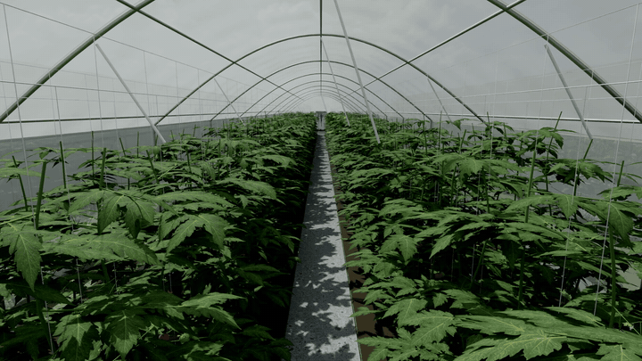

# RoboFarm



*R1 (R181-S) driving itself down tunnel-09 on its real AI-driven route, filmed by the greenhouse CCTV camera in the Isaac Sim digital twin. 8x speed, no cuts.*

**R1 is our greenhouse robot: it enters a house it has never seen, maps it, finds sick plants, and decides by itself where to look again.**
Built for the *Nebius x NVIDIA Global AI Hackathon 2026 — Physical AI track*. Thai docs: [README_th.md](README_th.md).

- **Brain — HERMES:** [Hermes Agent](https://github.com/NousResearch/hermes-agent) is the agent runtime, running **NVIDIA Nemotron 3** on **Nebius Token Factory**. It picks goals (survey, revisit, dock), never wheel speeds.
- **Eyes:** **NVIDIA Cosmos Reason 2** on a **Nebius Serverless Endpoint** / RTX PRO 6000 VM. It inspects the 6 side-camera views of tomato plants and checks from the front camera that the robot moved as commanded.
- **Cloud SLAM AI:** **Nebius GPU Jobs** run feed-forward 3-D reconstruction (MapAnything, VGGT fallback) on robot or drone video. The result is aligned to the greenhouse map.
- **Robot (edge):** the R1 differential-drive robot, simulated in **NVIDIA Isaac Sim** in a digital twin built from our real farm. It runs a rule-based driver (BOOK), a SAFETY layer and MISSION legs that are identical for the real Jetson.
- **Evaluation at scale:** Isaac Sim batch jobs randomise wet-floor friction, obstacles and start offsets, and report success rates against the acceptance criteria below.

```
 Edge: R1 (Isaac twin → Jetson)            Nebius
  SAFETY · MISSION · BOOK · pose ──frames──▶ robot API hub ──▶ Cosmos Reason (Serverless Endpoint)
            ▲ goals only                      │ findings
            └──── HERMES (Hermes Agent + Nemotron @ Token Factory) ◀┘
                     Cloud SLAM AI + Isaac eval  (Nebius GPU Jobs)  ──▶ live dashboard
```

## Sim-to-Real
1. **Real → Sim (done):** the tunnel-09 twin is calibrated against real photos (aisle brightness: real 126, Isaac 128). We also have a real drone survey of the site, and the robot's bill of materials uses parts sold in Thailand.
2. **Sim:** all modules are developed and evaluated in the twin. Real photos and the real drone video go through the same cloud pipeline.
3. **Sim → Real (next):** `r1_nav/` uses only sensors (no simulator pose). Moving to the Jetson means swapping `sim_adapter` for ROS 2.

## Repo map
| Path | What |
|---|---|
| `r1_nav/` | Aisle map, mission legs, BOOK LiDAR aisle-centring controller, goal validation (`commands.py`), 7-camera schedule (`cameras.py`), farm site map between greenhouses (`site_map.py`) |
| `cloud/maps/`, `scripts/extract_site_map_v18.py` | Site-map drafts from the V18 model, a farmer's sketch (Nemotron VL) or a drone top-down; human confirms before use ([docs/SITE_MAP_th.md](docs/SITE_MAP_th.md)) |
| `sim/`, `scripts/run_demo_sim.py` | Leg executor (STUCK, rear stop, heading damping), cloud link with offline outbox, Isaac wrapper, kinematic fake backend |
| `scripts/run_eval_job.py`, `jobs/isaac_eval/` | Batch evaluation (wet floor / obstacle / offsets) as a GPU job |
| `agent/robot_api.py` | Goal hub between HERMES, the robot and Cosmos; writes the dashboard data |
| `agent/hermes_skills/r1-robot-control/` | Hermes Agent skill that commands the robot |
| `agent/brain_loop.py` | Deterministic fallback brain (same policy; Nemotron writes the reasoning and the farmer report) |
| `cloud/eyes/` | Cosmos Reason serving (vLLM) and an inspection client with strict JSON output |
| `cloud/brain/` | Nemotron client for Token Factory and the Hermes provider config |
| `cloud/mapping/` | Cloud SLAM AI job (MapAnything / VGGT) and alignment into house metres |
| `dashboard/` | Live map, finding pins, 7-camera views, HERMES decision feed |
| `deploy/nebius/` | One-VM stack (RTX PRO 6000): bootstrap and docker compose |
| `docs/` | Mission spec, interfaces, environment, roadmap, hackathon plan (Thai) |

## Evidence that it runs
Real logs and outputs, unedited: cloud install on a fresh Nebius VM, the robot hand-off and the full pipeline (9 min 59 s to the farmer's report), the robot side on a **real Jetson Orin Nano** (install, 50 tests, upload to the cloud and the report back), and the run-3 recording the robot made while driving itself: **[docs/evidence/](docs/evidence/README.md)**.

## Gallery
22 images (sim renders, real farm photos, the driven route) with captions: [docs/media/gallery/](docs/media/gallery/README.md)

## How the robot knows where it is
Sensors, the self-built map, the LiDAR estimator (0.26 m over the farm), cuVSLAM as a second observer (6.4 cm; 188 FPS on the Jetson), their fusion, and relocalisation when the robot is put down anywhere (LiDAR candidates → Nemotron VL tie-break, 83 % → driving confirms) — one document with figures and every experiment: **[docs/LOCALISATION_REPORT.md](docs/LOCALISATION_REPORT.md)**.

## The robot makes its own map (teach mode)
Walk or push the robot through the farm once with the recorder on; `scripts/teach_map.py` turns that drive into the
LiDAR map the robot localises on and the site graph it plans routes on — dock, doors, paths with measured lengths. The
farmer names the houses and confirms; nobody types a distance or draws a route. Verified on run 3: 32 967-point map,
5-node site graph, 1 500 / 1 500 scans localised on the self-built map at 0.23 m RMSE
([docs/NEW_SITE_GUIDE.md](docs/NEW_SITE_GUIDE.md) — taking the robot to a new farm, why a person leads the first drive, how to send it to house 5 or 6 or every house; [docs/INSTALL.md §2d](docs/INSTALL.md), [evidence 10](docs/evidence/README.md), [figure](docs/media/gallery/24_teach_map_self_built.png)).

## Supported platforms (tested)

| Part | Platform | Status |
|---|---|---|
| **Robot** software (`r1_nav`, recorder, hub client, `robot_upload_run.py`) | **NVIDIA Jetson Orin Nano Super 8 GB**, JetPack 6 (L4T R36.4), Python 3.10 | **verified**: install 1 min 33 s, 50 tests, hand-off to the cloud and report back |
| | ARM64 Linux (NVIDIA DGX Spark, Ubuntu, Python 3.13) | **verified**: install, 50 tests, cross-network hand-off |
| | any Linux with Python ≥ 3.10, `rsync`, `ssh` | expected (pure Python: numpy, pillow, scipy) |
| **cuVSLAM** on the robot (R181-S stereo) | Jetson Orin Nano, cuvslam 17.0.1 cu12 aarch64 wheel, JetPack CUDA 12.6 | **verified**: 188 FPS stereo, 82 FPS stereo-inertial |
| **Cloud** (hub + analysis pipeline) | **Nebius `gpu-rtx6000`** (RTX PRO 6000), Ubuntu 24.04 + CUDA 13 image, Python 3.12 | **verified**: install 2 min 15 s, full pipeline 9 min 59 s |
| | any x86-64 Linux + NVIDIA GPU, CUDA 12.x or 13.x (`TORCH_INDEX` cu128 / cu130) | expected |
| | CPU only | pipeline runs with `detect` on CPU (slow) and GPU steps skipped |
| **Simulation** (digital twin, `scripts/run_farm.py`) | NVIDIA Isaac Sim 5.1 on x86-64 + RTX GPU (Nebius `gpu-rtx6000` used) | verified for all recorded runs |
| **Models** | Nemotron 3.5 Super VL, Nemotron 3 Super — Nebius Token Factory (hosted) | verified; one `NEBIUS_API_KEY` |
| | Cosmos Reason 2 — self-hosted vLLM container (`deploy/nebius/docker-compose.yml`) | verified on the Nebius VM; optional |
| | RT-DETRv2 fine-tuned weights | **not in git — request from the author** (77 MB); without them `detect` is skipped |

Install steps and the logs of every "verified" row: [docs/INSTALL.md](docs/INSTALL.md), [docs/evidence/](docs/evidence/README.md).

## Install and run (cloud + robot)
Step-by-step install for both halves, verified from a fresh clone on a Nebius RTX PRO 6000 VM (cloud) and on a **Jetson Orin Nano** (robot): **[docs/INSTALL.md](docs/INSTALL.md)**.
Fine-tuned detector weights are not in this repo: contact the author (see INSTALL.md).

## Quick start
```bash
python3 -m pytest -q                                   # offline tests (no GPU, no network)

# Full loop rehearsal without GPU (fake robot + stub eyes):
python3 scripts/stub_eyes.py --port 8001 --spot 15 &
EYES_BASE_URL=http://127.0.0.1:8001/v1 EYES_MODEL=stub EYES_API_KEY=x \
  python3 agent/robot_api.py --data runs/demo --map data/tunnel09_aisle_map_v18.json --port 8090 &
python3 dashboard/serve.py --data runs/demo --port 8080 &          # open http://127.0.0.1:8080
python3 scripts/run_demo_sim.py --backend fake --idle-exit-s 60 &
python3 agent/brain_loop.py --house tunnel-09                     # or: hermes, with the r1-robot-control skill
```
Real stack on Nebius: [deploy/nebius/README_th.md](deploy/nebius/README_th.md). Cloud details and verified model IDs: [cloud/README_cloud.md](cloud/README_cloud.md).

## Phase-1 acceptance criteria (Isaac, tunnel-09 photo-matched scene)
1. Stop at a commanded point in the centre aisle within ±0.15 m, side clearance ≥ 0.05 m, 10/10 runs.
2. Full aisle in and reverse out, no collision, stop within 0.5 m of an obstacle, 10/10 runs.
3. Side images with (aisle, metre, time) every 0.5 m (`docs/INTERFACES_th.md`).
4. One aisle (76 m round trip) in ≤ 8 min at 0.25 m/s.

## Honest status
- The robot drives in the Isaac Sim twin of our farm; the recorded full-farm run (dock → tunnel-09 → yard → tunnel-10 → dock, 117 m, 161 plant stops) is the source of every result here. The physical chassis is being assembled; the robot software has been installed and tested on the real Jetson Orin Nano and has handed a survey to the cloud from it.
- Two side aisles of tunnel-09 (0.55 m) are narrower than the robot plus margin and are reported as skipped, not attempted.
- Fruit grading works; plant counting from the side cameras and whole-plant symptoms (wilting, defoliation) are the next targets. Disease screening is a visual aid, not a diagnosis.
- cuVSLAM is verified on recorded data and on the Jetson; its live fusion with the LiDAR localiser on the robot is the next step. No policy training was done for this entry.
- Fine-tuned detector weights are available from the author on request.

## License and credits
Apache-2.0 (see `LICENSE`). Third-party models keep their own licences (see `cloud/README_cloud.md` and `cloud/mapping/README_mapping.md`).
The R1 concept is inspired by Sumith Shridhar's R1; no code or models from it are used.
