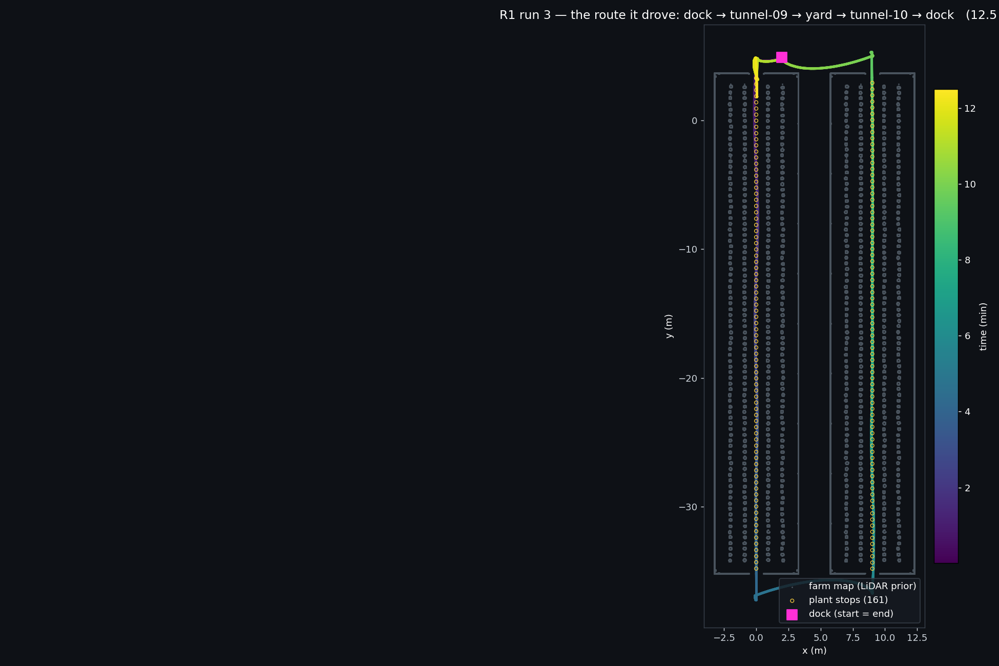
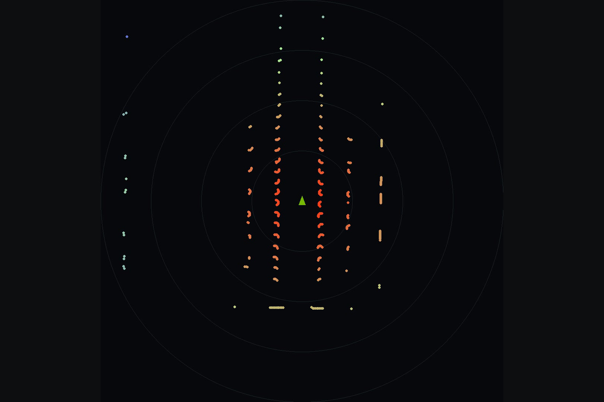
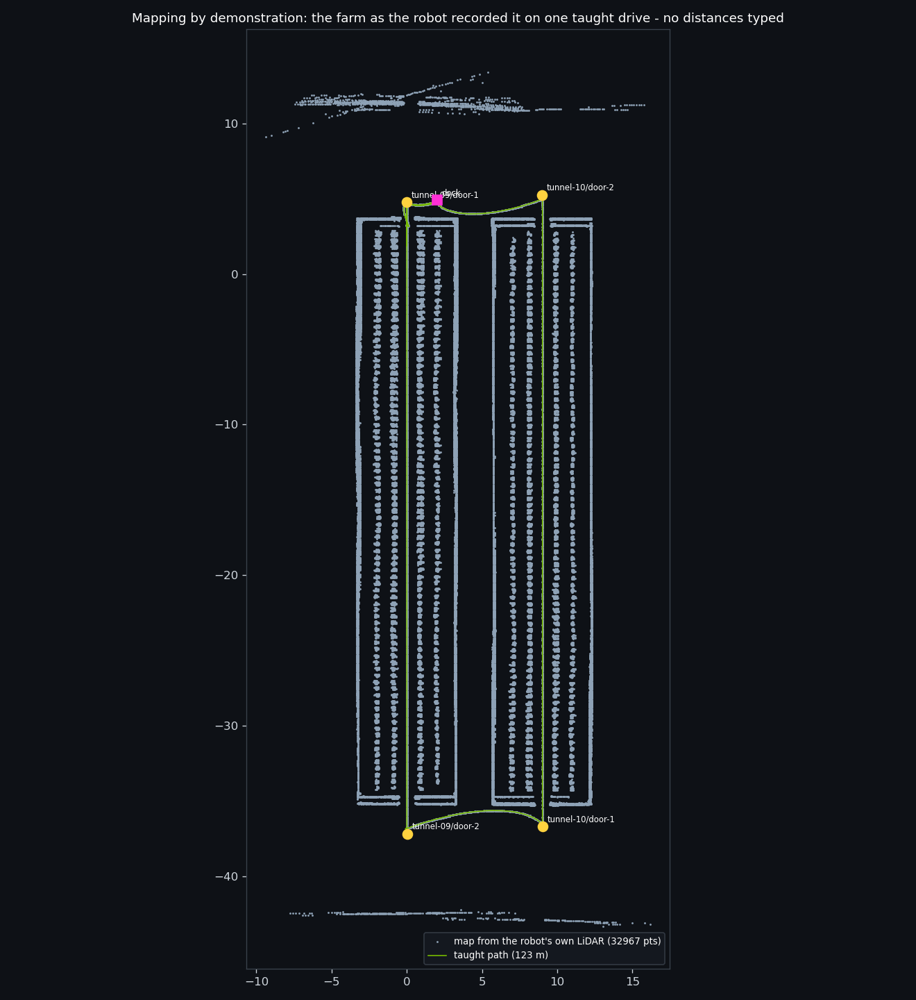
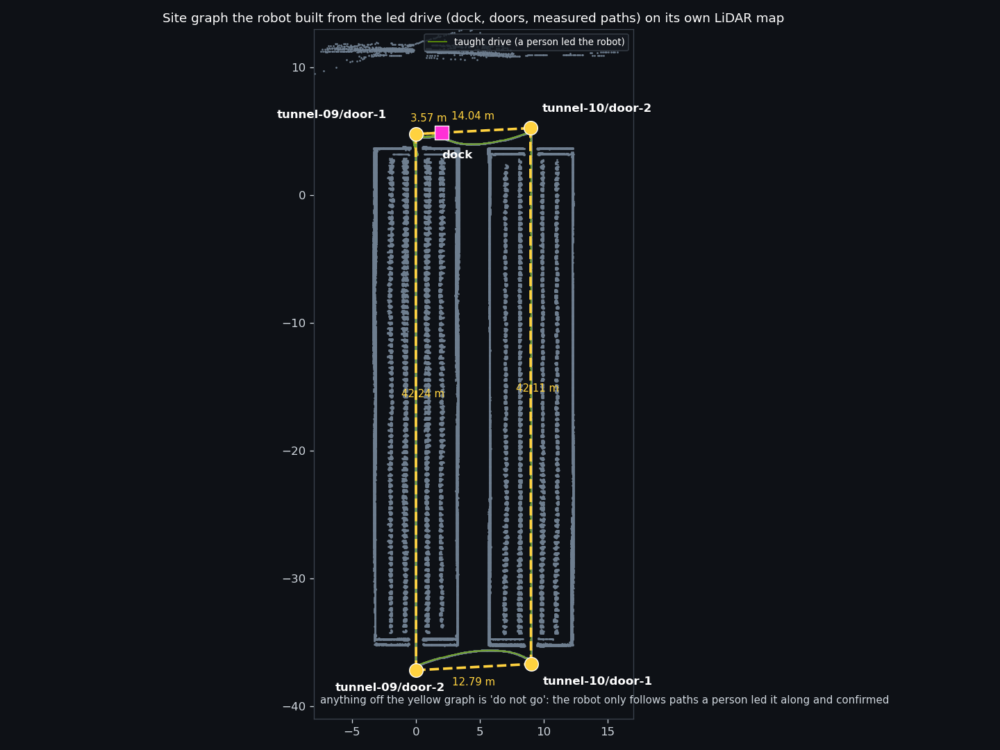
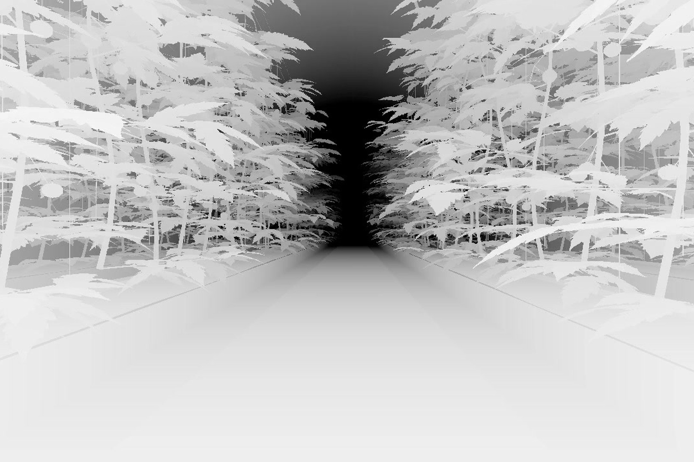
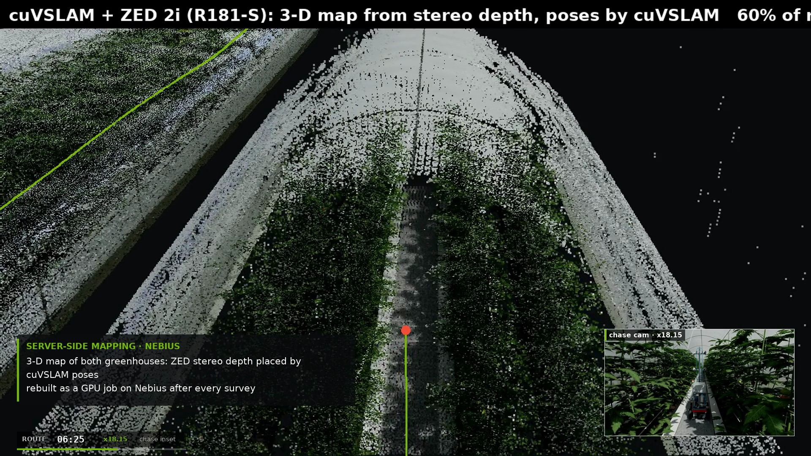
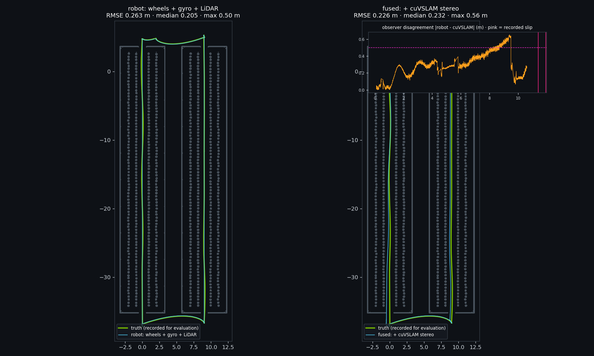
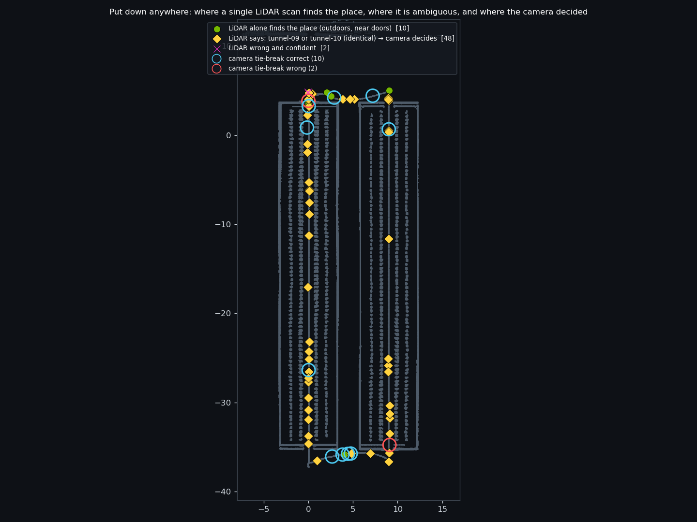
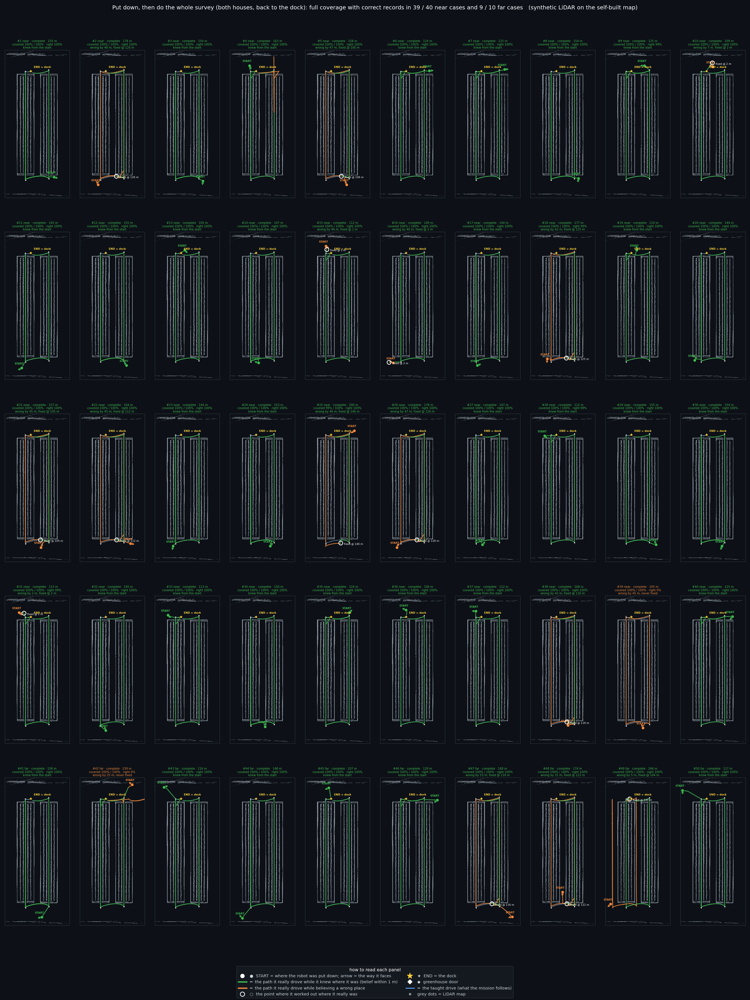
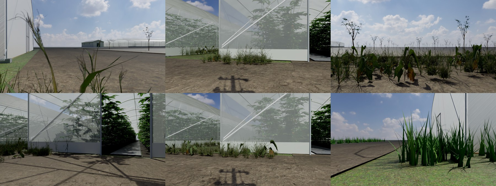

# How RoboFarm knows where it is

The complete account of localisation on R1 / R181-S: the sensors, the map, the three estimators, how the robot maps a
new farm from one led drive, and how it finds itself when it is put down somewhere other than its dock. Every number
is from the recorded full-farm run (run 3) in the Isaac Sim twin of our farm; the files behind each number are listed
in Section 8.

*Figure 1 — Run 3: dock → tunnel-09 → yard → tunnel-10 → dock, 117 m, 12.5 min, 161 plant stops, driven on sensor
data alone. The recorded ground truth was used only to score the estimates below.*

---

## 1. The question

A robot in a greenhouse has no GPS, no painted lines, no tags on the posts — we do not allow fiducial markers, because
a farm must not have to be rebuilt around the robot. Every plant looks like the next one, the two tunnels are identical,
the floor is dirt in the yard and concrete in the aisles, and the wheels slip when it is wet. The robot has to answer
"where am I?" ten times a second from what it senses, and it has to know when it does not know.

## 2. What it senses

| Sensor | On | Used for |
|---|---|---|
| 2-D LiDAR (RPLIDAR C1 class, 500 beams, 10 Hz) | R1, R181-S | scan matching against the map; lateral offset and heading from the planting-bed walls; obstacle stop |
| Wheel encoders (4 × skid-steer) | R1, R181-S | distance travelled |
| IMU gyro | R1, R181-S | heading between scans |
| ZED 2i stereo camera (12 cm baseline) + IMU | R181-S | NVIDIA cuVSLAM visual odometry and the 3-D map; the front image for place recognition |
| Six mast cameras | both | plant inspection (not localisation) |

*Figure 2 — One LiDAR scan: the two planting-bed walls either side, the aisle ahead, the far opening.*

## 3. The map: made by the robot, from one led drive

The robot does not navigate on a drawing. The first time it sees a farm a person leads it once along every path it may
use — dock, door, aisle, the yard to the next house, home — with the recorder running (`steps.jsonl`: scans + the
robot's own pose estimate at 10 Hz). `scripts/teach_map.py` turns that drive into:

- **`prior_map_xy.npy`** — the farm as the LiDAR saw it: every scan placed with the robot's own pose, 5 cm cells, cells
  hit twice or more. Run 3 as the led drive: 29 615 points covering both greenhouses, the yard and the road.
- **`site_map.json`** — the site graph: the dock, a door node wherever the drive entered or left a house, edges along
  the taught path with their measured lengths (3.6 m dock → tunnel-09 front; 42.2 m through tunnel-09; 12.8 m behind
  the houses; 42.1 m through tunnel-10; 14.0 m home), each aisle's measured length (41.5–41.6 m). The farmer renames
  the houses and confirms; anything off the graph is "do not go".

Nobody types a distance. A person leads the first drive because a farm has ponds, an orchard, a road and soft ground
that a robot must not learn by driving into them: the led drive defines where it may go.

*Figure 3 — The map the robot built from the led drive, with the taught path, the dock and the door nodes.*

*Figure 4 — The site graph on the same map: dock, doors, measured path lengths.*

**Does the robot localise as well on its own map as on a drawn plan?** Re-localising the same 1 500 scans on the
self-built map accepted every scan (1 500 / 1 500) at 0.23 m RMSE, equal to the plan-derived map (0.23 m). Returns from the robot's own mast and electronics box (about 9 beams per scan, 0.3–0.6 m behind the LiDAR) are removed before mapping; left in, they draw a trace of the robot along the taught path and the map starts to behave like a painted line. The
self-built map carries the pose error of the drive that taught it (median fix 0.14 m against 0.03 m on the plan);
building it from cuVSLAM poses is the next refinement.

## 4. Estimator 1 — wheels, gyro and LiDAR scan-to-map (what drove run 3)

Between scans the wheels and gyro count the motion. Ten times a second the LiDAR scan is matched to the map by
iterative closest point: the scan is placed at the current estimate, every beam end is paired with its nearest map
point, and the pose that best aligns them is found. The match reports its own quality — the share of beams that found
a map point within 30 cm, their RMS distance, and how far the correction would move the robot. A good match (typically
98 % of beams, 7 cm RMS) is applied; a poor one is refused, so a wrong guess is never accepted because it was made
confidently. Outdoors the x–y correction is applied; inside an aisle the LiDAR fixes lateral offset and heading from
the bed walls while the wheels track progress along the row, and the aisle ends and doorways reset the count.

Result on run 3, the whole farm, no trajectory alignment: **0.26 m RMSE** against the recorded truth (median 0.21 m,
max 0.50 m); outdoors 0.04 m, inside the aisles 0.30 m. Isaac Sim's true pose was never given to the robot.

## 5. Estimator 2 — cuVSLAM on the stereo camera (R181-S)

NVIDIA cuVSLAM tracks thousands of visual features frame to frame on the ZED 2i stereo pair; the 12 cm baseline gives
metric scale with no external reference. It does not need the plants to differ from each other — feature tracking
needs texture, not uniqueness — so it keeps measuring motion where every plant looks alike.

- Full route, Astra re-render, 6 476 frames: **6.4 cm RMSE over 111 m** after Sim(3) alignment, fitted scale 1.003
  (metric). Stereo-inertial 21.8 cm; RGB-D failed (13.8 m); monocular 15.8 m — stereo is the configuration.
- **On the real Jetson Orin Nano Super (25 W): 188 FPS stereo, 82 FPS stereo-inertial**, 600/600 frames tracked over
  60 s / 11 m, ATE 3–4 mm on the segment — far faster than the 10 Hz control loop.

*Figure 5 — ZED 2i stereo depth from the robot's own camera.*

*Figure 6 — The 3-D map: stereo depth frames placed with cuVSLAM's poses.*

## 6. Two observers, fused

Estimators 1 and 2 fail in different ways — wheel slip is invisible to the wheels but not to the camera; a repeated
greenhouse fools the LiDAR but not the feature tracker's motion — so each watches the other. Placed in the farm frame
from the dock pose and the robot's own first 20–60 s of motion (never the truth), cuVSLAM agrees with the LiDAR estimate
to 0.2–0.5 m over the whole route; fusing cuVSLAM's relative motion with the LiDAR map corrections, with the camera-to-
farm alignment kept current by the scan-to-map fixes, gives **0.23 m overall and 0.26 m in the aisles against 0.30 m
for the LiDAR estimate alone (≈ 12 % better)**; outdoors both are 0.04 m.

*Figure 7 — Left: the robot's LiDAR estimate against the truth. Right: fused with cuVSLAM. Inset: the disagreement
between the two observers along the route.*

## 7. Put down anywhere: relocalisation

If someone places the robot somewhere other than the dock — on a path it knows — it does not assume the dock. It
finds itself in three steps, and says when it cannot.

**Step 1 — LiDAR candidates (74 ms).** `sim/relocalize.py` tries every place along the taught path (every 0.5 m,
both directions: 1 476 hypotheses on our farm), scores each by the share of the current scan that lands on the map
there, refines the best twelve with the driving matcher, and flags ambiguity when two far-apart places fit equally.
From single scans at 40 random places on run 3: **8 found outright (5 cm median error), 30 flagged ambiguous, 2 wrong**.
Outdoors — dock, road, yard, doors — the scan is distinctive; inside an aisle tunnel-09 and tunnel-10 are the same to a
LiDAR, and the honest output is "tunnel-09 or tunnel-10, same spot in either".

**Step 2 — the camera decides (5 s).** For an ambiguous pair, the robot's current front image and a reference image
from the led drive at each candidate place (taken ~1.5 m before the candidate — a different viewpoint of the same
place, never the current frame) go to Nemotron 3.5 Super VL with one question: which reference shows where I am?
On 16 ambiguous run-3 scans it **decided 12 and was right in 10 (83 %)**; the other 4 ran out of reply length. Its
evidence is what a LiDAR cannot see — quoted from the model:

- *"Image 1 and Image 3 both show the same solitary small tree visible through the doorway at the end of the row."*
- *"…a smooth white wall with a grey block at the base and no foreground vegetation, whereas Image 2 features tall…"*
- *"…the greenhouse structure on the left with green plants at its base, a black irrigation line on the ground…"*
- *"…a solid white greenhouse wall with a grey block at the base and the same distant building…"*

**Step 3 — driving confirms.** Surviving candidates are carried along as the robot moves and refined on every scan; a
candidate that stops fitting the map dies. Driving is not allowed to choose between symmetric rivals: left to the LiDAR
alone, driving on chose the wrong twin 9 times in 10 on run 3. The choice stays with the camera, or with reaching a
place that is not symmetric — a door, the dock, the road.

*Figure 8 — 60 random put-down points on run 3: green, a single LiDAR scan finds the place; yellow, the LiDAR says
"tunnel-09 or tunnel-10"; magenta, wrong; circled, the camera's tie-break (blue correct, red wrong).*

**Off the taught path.** A robot put down beside a path sees surfaces the led drive never recorded, so the led drive
records more: every 0.5 m along the path the robot also scans at eight headings, and those look-around scans are
merged with the taught map (984 look-around poses, 29 615 → 34 084 map points on our farm). The search then covers
every free cell of the map as well as the path (0.5 m grid × 24 headings, 101 148 hypotheses, 0.6 s per scan), and the
chosen pose gets its way home by rejoining the nearest graph node and following the normal route
(`SiteMap.route_from_xy`, refused beyond 6 m from the graph). Measured with LiDAR scans and front images rendered in
the current twin at 40 poses 1–3 m beside the path, in the front and back yards: the LiDAR settles 5 outright and
flags 33 as ambiguous (the right place leads in 14 of them); Nemotron 3.5 Super VL compares the front image with the
look-around reference image of matching heading at each candidate place, decided 28 and was right in 20; the final
pose is correct and a route to the dock is planned in **25 of 40 (62 %)**. The reference image must share the
viewpoint: with frames from the led drive as references the camera was right in 13 of 40. Evidence:
`docs/evidence/14_offpath_relocalisation_lidar.json` (LiDAR stage), `15_offpath_full_loop_summary.json` and
`15_offpath_full_loop.jsonl` (the full loop, per case).

**Then do the mission.** A put-down is only worth something if the survey that follows is complete and its records
carry the right house and metre, so the test continues from the believed pose (right or wrong) through the whole
mission: rejoin the taught path, the aisle of tunnel-09, the yard, the aisle of tunnel-10, the dock
(`scripts/offpath_mission_eval.py`, LiDAR scans synthesised on the self-built map). While driving, the believed place
is checked against every scan, a fresh whole-map search every 10 m keeps rival places alive, and a belief that stops
fitting, an obstacle where the map says the way is free, or a rival that fits clearly better over 2 m of driving
becomes a new anchor: the whole odometry history is re-placed, the plant records made so far are relabelled, and the
mission goals are re-derived from the corrected history. Before docking, Nemotron VL compares the view with the dock and
with the strongest rival place. On the 40 near put-downs the survey was completed with every plant stop covered in 40
of 40 and the records labelled right in 39 of 40; 13 had started with a wrong belief and 12 were corrected, 4 by the
scans within 2 m and 8 by the camera at the dock after a complete, then relabelled, survey. On 10 further put-downs
4–8 m from the path (LiDAR guess alone to start) the survey was complete in 10 of 10 and right in 9 of 10. Evidence:
`docs/evidence/16_offpath_mission_survey.json` (per case: every decision and the path driven).

*Figure 10 — Put down, then do the whole survey: for each of the 50 put-down poses the path really driven (green while
the robot knew where it was, orange while it believed a wrong place), the point where it worked out where it really was,
and whether the plant records carried the right house and metre.*

**Without a stored route.** The led drive is a way to collect scans safely; the robot does not need its path afterwards.
From its own map alone (`scripts/free_nav.py`) it marks every 0.25 m cell that a LiDAR ray has crossed and that lies
farther than its half-width from any map point - space it has seen empty and can fit through; ponds, orchard and road
are never marked because it never saw them empty. It finds the dominant wall direction from the points, and the long
narrow free corridors between parallel rows with layered sides (stems, bed edge, next row) are the plant aisles; the
dock is where it was switched on. The mission is decided from that structure - which aisles, in what order - by the
agent's model (Nemotron 3 Super through Nebius Token Factory, with its reason kept) or by a nearest-first rule; every
path is then planned on the free grid when it is needed (A* with a clearance cost, which is why the robot keeps to the
middle of an aisle), from where the robot believes it is, and planned again whenever the belief changes or something
unexpected appears. Figure: `media/gallery/30_free_nav_structure.png`. Measured the same way as above, 40 near put-downs and 10 in the open, with an
obstacle that is not on the map dropped on the planned path in every case and HERMES reviewing the plan on the map
picture first: the survey was completed in 39 of 40 near cases (every row fully covered in 38, records right in 36;
12 of the 13 wrong starts corrected) and in 10 of 10 far cases (9 right); the unexpected obstacle was driven around in
41 of the 50; HERMES approved 31 plans and changed 10. Inside a row the robot asks for no pictures, odometry carries
its belief; at every doorway, when the LiDAR still keeps the twin place alive, the agent decides from the whole
situation (both places with their LiDAR fit, the metres driven, the doors passed, the verdicts so far, the plan, and the
live view against both reference views) and a move is accepted only after two doorways agree and the LiDAR fits the
rival at least as well. Measured the other ways for the record: pictures every 10 m inside the rows gave 36 of 50 with
88 belief changes, single doorway verdicts without the two-doorway rule 39 of 50, the camera at the dock alone 43 of 50. The order came from the Rural Postman solver on the robot
(every chosen aisle a required edge, A* distances between aisle ends and the dock, about 0.1 s), so the model decides
which aisles and whether the plan is sound, never the geometry. Evidence: `docs/evidence/17_freenav_mission_survey.json`;
figures `media/gallery/31_freenav_survey_each_case.png`, `32_freenav_survey_overview.png`.

**Three ways to run a survey, from the same map.** (1) *Taught route*: the robot follows the corridors of the led
drive, node to node, with the site graph deciding what is allowed; the simplest and the one every number above was
measured on. (2) *Map only*: no route is kept; the robot finds the aisles and the drivable space in its own map, the
agent's model decides the order from that structure, the robot plans every path itself and plans again when something
unexpected appears. (3) *Map only with HERMES review*: as (2), and before the robot moves HERMES sees the plan drawn on
the map together with every leg's length and the alternatives, and approves or changes it; the same channel takes the
robot's reports during the mission (an aisle blocked, a place that does not look like the map) for the next decision.
A farm with ponds, an orchard and a road is run in (1) until its map has been seen widely enough for (2).

**Before the robot drives on its own in the field: a live ground check.** A 2-D LiDAR at 0.55 m returns nothing from
a drop-off and nothing from still water, so a map alone can send the robot into a pond or a ditch that the map never
held. A layer on the Jetson therefore gets the right to veto every forward command: the ZED 2i depth image flags a
ground plane that drops away or returns no depth within 2–3 m ahead, and a small real-time segmentation model
(SegFormer-B0 or PIDNet class, TensorRT) labels the ground ahead as drivable, water, ditch, vegetation or person. Two
frames per second are enough: at 0.3 m/s that is a check every 15 cm, about 5 % of the Orin Nano's GPU, trained on
the twin's render passes and real farm photographs. The vision-language models are too slow to be this brake; they
reason, the ground layer stops. On "not drivable ahead" the robot stops, marks the place on its map and plans again,
whatever the planner or HERMES asked for. The same pass labels the plants: canopy, stems, fruit and yellowing leaves become a plant layer of the map (where the rows really hold plants, where to stop for the close look), while the fine grading of fruit and lesions stays with RT-DETRv2 at the stops and Nemotron VL.

*Figure 9 — Six of the 40 off-path put-down poses, rendered in the current twin: these front views go to Nemotron VL
to decide between the places the LiDAR cannot tell apart.*

What the farmer sees: "relocalised at tunnel-10, metre 14 (camera: the tree through the door)" or "ambiguous:
tunnel-09 or tunnel-10 — moving to the door to check". The robot never silently guesses. Wiring this into the live
start-up of the robot is the next step; everything above is measured offline on the recorded drive.

## 8. Experiments and evidence

| Experiment | Result | File |
|---|---|---|
| LiDAR + wheels + gyro on the whole farm | 0.26 m RMSE, no alignment; outdoors 0.04, aisles 0.30 | `docs/evidence/08_two_observer_fusion_run3.json` |
| cuVSLAM stereo, full route | 6.4 cm RMSE / 111 m, scale 1.003 | `render_v2_astra_scene/cuvslam/cuvslam_stereo_q.json` |
| cuVSLAM on Jetson Orin Nano | 188 FPS stereo, 82 FPS inertial, 600/600 tracked | `docs/evidence/09_cuvslam_on_jetson.json` |
| Two-observer fusion | 0.30 → 0.26 m in the aisles | `docs/evidence/08_two_observer_fusion_run3.json` |
| Map by demonstration | 29 615 points, 5-node graph, 1 500/1 500 scans at 0.23 m | `docs/evidence/10_teach_map_run3.json`, `10_teach_site_map_run3.json` |
| Relocalisation, single scan | 8 found / 30 ambiguous / 2 wrong of 40; 74 ms | `docs/evidence/13_relocalize_eval_run3.json` |
| Camera tie-break (Nemotron VL) | 10 of 12 decided correct (83 %) | `docs/evidence/12_vlm_place_check.jsonl` |
| Motion-only decision in twin houses | wrong 9 of 10 → not used to decide | `docs/evidence/13_relocalize_eval_run3.json` |
| Off the path: look-around map + camera, route home | 25 of 40 put-downs 1–3 m beside the path | `docs/evidence/15_offpath_full_loop_summary.json`, `14_offpath_relocalisation_lidar.json` |
| Camera-only mapping methods benchmarked | lingbot-map 1.06–1.22 m; others 7–16 m | `docs/SYSTEM_OVERVIEW.md` §7 |

Code: `sim/scan_localizer.py`, `sim/lidar_odometry.py`, `sim/executor.py` (estimator 1); `scripts/cuvslam_r181.py`,
`scripts/fuse_localisation.py` (estimator 2 and fusion); `scripts/teach_map.py` (map by demonstration);
`sim/relocalize.py`, `scripts/relocalize_eval.py`, `scripts/vlm_place_check.py` (relocalisation). Tests:
`tests/test_scan_localizer.py`, `test_lidar_odometry.py`, `test_teach_map.py`, `test_relocalize.py`.
