# RoboFarm: an autonomous greenhouse scout robot with NVIDIA models on Nebius — technical report

*Draft for language editing (30 Oct 2026). Every number comes from the runs of 28–29 Oct 2026; the source files are listed in the appendix. Where two scenes were used, "original scene" means the first farm twin that the robot drove live (run 3) and "Astra scene" means the permanent, photo-matched scene on which run 3's recorded route was re-rendered with every camera.*

---

## Abstract

Frontier RoboFarm is an autonomous greenhouse scout: a narrow four-wheel robot (R1, and the stereo-camera flagship R181-S) that drives tomato-greenhouse aisles on its own, photographs every plant from six mast cameras, and hands each survey to a cloud pipeline on Nebius that grades fruit, screens plant health with NVIDIA Nemotron, builds a 3-D map and writes the farmer's report in Thai and English; an agent (HERMES, Nemotron 3 on Nebius Token Factory) sets the robot's goals. The system follows the Physical AI track brief — an embodied edge agent coordinated by an agent runtime, with NVIDIA models and Nebius GPUs — and was developed in an NVIDIA Isaac Sim digital twin of our own farm. On the recorded full-farm run the robot covered 117 m and 161 plant stops on sensor data alone with 0.26 m localisation error; stereo cuVSLAM held 6.4 cm over 111 m and runs at 188 FPS on a Jetson Orin Nano; both halves install from a fresh clone and were verified end to end on a Nebius RTX PRO 6000 VM and on the Jetson.

## 1. Introduction

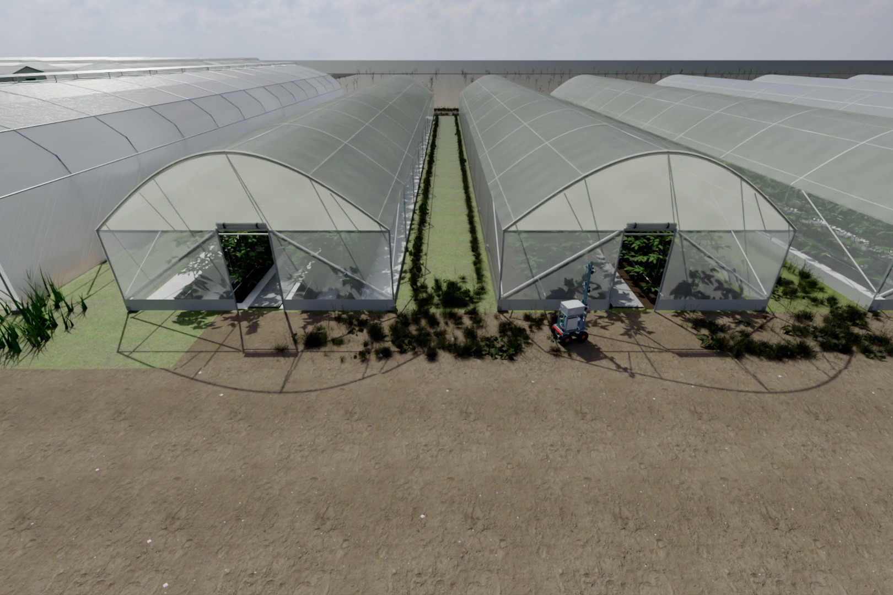

*Figure — The farm's digital twin in NVIDIA Isaac Sim: CCTV view as R1 leaves its dock*

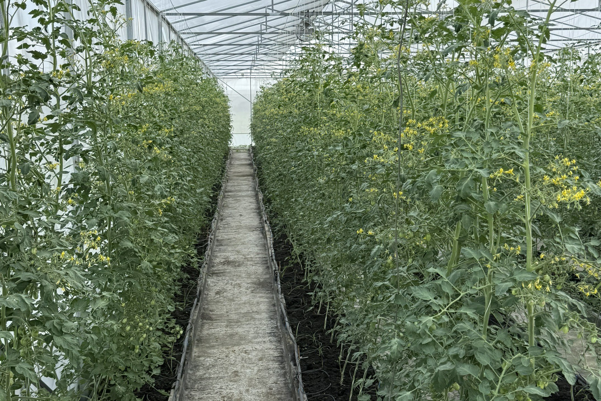

*Figure — The real farm: inside a tomato tunnel the twin was built from*

Agriculture sustains millions of livelihoods and underpins food security, and much of its essential work is still repetitive manual labour. In a tomato greenhouse a farmer inspects hundreds or thousands of plants one by one — checking health, judging ripeness, looking for problems before they spread. Frontier RoboFarm began with one question: how can a farmer monitor thousands of plants, detect problems early and make better decisions without walking every row? The answer had to be affordable, practical and accessible.

We started from real greenhouse environments in Thailand and built an autonomous robot that navigates on its own, inspects crops at close range, collects consistent plant-level data and turns observations into actions a farmer can take. Thailand is the starting point; the problem is shared by farmers everywhere. We designed and assembled the robot ourselves from commercially available components with local sourcing wherever practical, so that farmers, researchers and developers can build, repair and adapt agricultural robots; the hardware will be published as an open-source project. RoboFarm is our expression of technological self-reliance — Physical AI brought out of the laboratory and into working farms.

**What the system does.** RoboFarm travels greenhouse aisles and the yard between greenhouses, stops at each plant, and photographs leaves, stems and fruit from six mast cameras at three heights on both sides of the aisle (Section 2). Every image is recorded with the position it was taken at, so a finding is evidence with a place a farmer can walk to (Section 3). The images are screened for fruit ripeness — ripe, turning, green — and for visible damage and leaf symptoms such as yellowing, leaf spots and fruit lesions (Section 4); harvest readiness and plant health are assessed and reported separately, and counts describe what the cameras observed. As it drives, the robot's stereo camera builds a three-dimensional map of the greenhouse, which records where it travelled and how the spaces connect and grows with repeated surveys (Section 3.4). On the route the robot watches for obstacles and interprets situations — a person, equipment, a blocked aisle — and its control and decision layers stop, wait or ask for a human as the situation requires (Sections 3.5, 5). When a finding needs confirmation, the agent sends the robot back to the recorded location for a second look before anyone is alerted (Section 5). Each survey ends with a report in Thai and English: ripe, turning and green counts; observed lesions and damage; plant-health findings with photographs and locations; revisit results; and the checks that need a person (Section 6).

The benefit is a farmer's time: scouting becomes the robot's job, and the farmer's attention goes to harvesting, to the plants flagged, and to the problems found early. The rest of this report describes the platform (2), localisation and navigation (3), perception (4), the agent (5), the cloud system (6), how everything was evaluated (7) and what follows (8).

---

## 2. Robot platform: R1 (R180) and R181-S

### 2.1 Mechanics and sensors

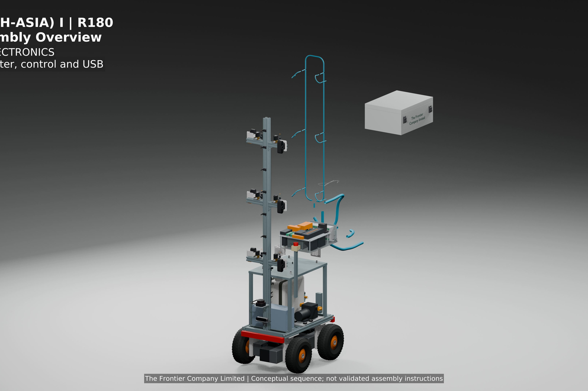

*Figure — R180 assembly overview from the CAD model (R181-S adds the ZED 2i stereo rig)*

| | R180 (run 3) | R181-S (Astra re-render) |
|---|---|---|
| Drive | 4-wheel skid steer, 0.53 m wide, 0.75 m long, 0.23 m/s in the aisle | same |
| LiDAR | Slamtec RPLIDAR C1 class: 2-D, 360°, 10 Hz, 0.05–12 m, 0.72° resolution (~500 beams/scan), scan plane ~0.55 m above the floor | same |
| Front camera | one RGB 1280×720 | **Stereolabs ZED 2i (polariser)**: two cameras, 12 cm baseline, 1080p30, depth 0.3–20 m, built-in IMU (~400 Hz); rectified 1080p fx ≈ 1066 px, ~84° horizontal |
| Side cameras | six fixed cameras on a mast, left/right × low/mid/high (0.79 / 1.21 / 1.64 m above the floor), 1080×1920 portrait (Rapoo C260 class) | same |
| Wheel odometry + gyro | yes | yes |
| Compute target | NVIDIA Jetson Orin | same (cuVSLAM runs on the Jetson) |

Skid steering was chosen because it has no steering linkage, tolerates mud and uneven ground, and can spin in place where the aisle is wide enough (the mission planner uses this: drive in, turn 180°, drive out with the cameras on the other side; in narrower aisles it reverses out). The side cameras are fixed, not panned, so every plant is photographed the same way every day; this is what makes day-to-day comparison possible.

R181-S changes only the front camera. The ZED 2i sits where the single camera was (`/Robot/Physics_Base/Sensors/front_rgb`); nothing else was retrained or re-tuned. Its three contributions are visual odometry with metric scale (cuVSLAM, §3.3), 3-D obstacles that a single-plane LiDAR cannot see (a hose on the floor, a hanging branch) and metric depth for the 3-D map (§3.4). The camera costs about US$549. Figure: `docs/media/figures/fig_r181s_zed_stereo_depth.jpg`.

### 2.2 Digital twin in Isaac Sim 5.1

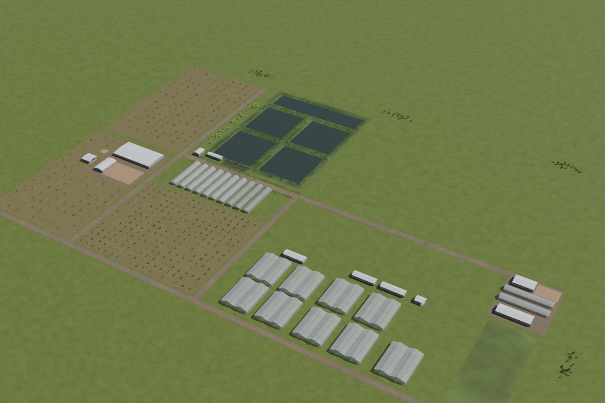

*Figure — The whole farm in the twin: greenhouses, ponds, orchard plots, sheds*

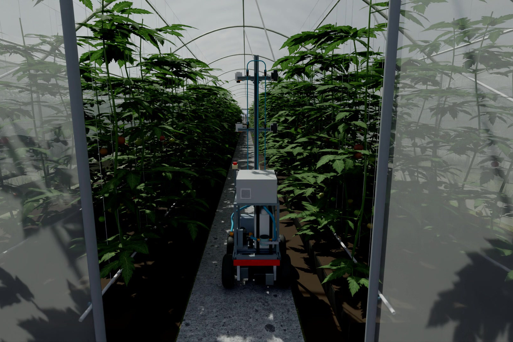

*Figure — R1 driving tunnel-09 in the twin, stopping at every plant (chase camera)*

The farm twin was built from our own photos and drone survey (two tunnels, tunnel-09 and tunnel-10, a yard between their back doors, a dock in front). Plants are 672 instances from the Tomato-Assets-V1 library, with nine synthetic anomaly plants hidden among them (2 chlorosis, 3 leaf spots, 2 fruit lesion, 1 wilting, 1 defoliation) whose positions are known only to the evaluation script.

- **Physics** at 120 Hz (PhysX). The LiDAR is the **PhysX range sensor** (`isaacsim.sensors.physx`), not the RTX LiDAR: it is cheap enough to update every physics step, which the navigation loop needs. Returns outside 0.05–12 m are turned into "no return", exactly as the real C1 reports them. Plants have an invisible stem cylinder collider (r = 0.10 m); leaf-card colliders caused false SAFETY stops and were removed. Details: `docs/LIDAR.md`.
- **Rendering**: RTX path tracing, 32 spp with the OptiX denoiser, HDRI daylight, exposure ISO 100 outdoors and ISO 400 inside the canopy for the side cameras. Side cameras render only at plant stops; during driving only the LiDAR and (in the re-render) the chase/front/ZED cameras run.
- **Astra scene** (29 Oct): the permanent version of the twin by our realism workstream, with proper door frames and rolled curtains, the yard connector, physics colliders authored in the scene instead of injected at runtime. Figure `fig_astra_doors.jpg`.
- **Re-render**: the recorded route of run 3 (`steps.jsonl`, 30 Hz robot pose) was replayed on the Astra scene with every camera — chase, front, six side cameras, ZED 2i left/right/depth + IMU, seven fixed CCTV cameras and three handheld bystander views that record only while the robot passes. About 25,000 frames on 16 RTX PRO 6000 GPUs (two VMs) in about two hours.

### 2.3 Sim-to-real strategy

The navigation code never reads the simulator's pose. `r1_nav/` and `sim/executor.py` consume only what the real robot will have: LiDAR scan, wheel encoders, gyro, camera frames; position along the aisle comes from a pluggable `PoseSource` (wheels + IMU odometry now, SLAM when available). The only simulator-specific module is `r1_nav/sim_adapter.py`, which turns Isaac observations into that interface; on the robot it is replaced by a ROS 2 adapter and the rest of the stack is unchanged. The body is built from parts sold in Thailand; the plan is a Jetson Orin running this stack with ROS 2.

---

## 3. Localisation, mapping and navigation

### 3.1 Why no fiducial tags

AprilTags or similar markers in a greenhouse would have to be printed, mounted, kept clean and kept in the camera's view through plant growth, film condensation and dust. They also fix the robot to one site. We decided early that the robot must localise from what is already there — walls, posts, beds, plant stems — using a prior map of the farm plus its own sensors. Everything below respects that constraint.

### 3.2 Wheel odometry, gyro and LiDAR


*Figure — A 2-D LiDAR scan in the robot frame: bed walls on both sides, the aisle ahead*


*Figure — Run 3, the route the robot drove on its own: dock → tunnel-09 → yard → tunnel-10 → dock, 117 m, 161 plant stops*

**Dead reckoning.** Wheel encoders give distance, the gyro gives heading; integrating them gives a pose that drifts (skid-steer scrub during turns, slip on a wet floor, gyro bias). Dead reckoning alone is the "guess"; the LiDAR corrects it.

**LiDAR odometry in the aisle** (`sim/lidar_odometry.py`). Consecutive scans are matched with scan-to-keyframe ICP (iterative closest point): find the rigid transform (Δx, Δy, Δθ) that minimises the sum of squared distances between the current scan points and their nearest neighbours in the keyframe. Plant stems and posts along the beds give the scan structure along the aisle, so the match measures how far the robot really moved, which the wheels cannot know when they slip. A bare corridor (two smooth walls) is degenerate along its axis; the implementation detects this (the match's information matrix is near-singular along the aisle) and falls back to the wheels for that axis.

**Scan-to-map localisation** (`sim/scan_localizer.py`). A prior 2-D map of the farm — a point set at LiDAR height containing walls, posts, door frames and plant stems in the scene frame — is matched to each scan with ICP, seeded by the odometry guess. In the simulation the prior map is built once from the twin's collision geometry with PhysX raycasts at the LiDAR height (`scripts/run_farm.py: build_prior_map`); on the real robot it comes from a mapping run or from the farm's site plan. Inside an aisle the match is applied to heading only (the two bed walls constrain lateral position well but the aisle axis is weakly observable); outside, where the greenhouse end walls and row ends are visible, it is applied to full position. The match is accepted only when its residual and inlier count pass thresholds; on run 3, 7,497 of 7,498 matches were accepted.

**Result (run 3, original scene, 123 m, 12.5 min of sim time, 7,500 control steps):** the robot's own position vs. truth had **RMSE 0.23 m, median 0.14 m, max 0.50 m**. On the Astra re-render of the same route the LiDAR+wheels reference is 0.25 / 0.18 / 0.49 m. Figures `fig_run3_route_vs_estimate.png`, `fig_lidar_2d_scan.png`, `fig_lidar_slam_map_astra_scene.png`.

### 3.3 Visual SLAM with cuVSLAM (R181-S)


*Figure — ZED 2i stereo depth from the R181-S camera*


*Figure — 3-D map of the greenhouse: stereo depth placed with cuVSLAM poses*

NVIDIA cuVSLAM is a GPU feature-based visual odometry/SLAM library. It tracks sparse image features across frames, triangulates them and estimates camera motion by minimising reprojection error, with local bundle adjustment over a sliding window and loop-closure-free drift behaviour that is adequate for a 100 m route. Three modes were evaluated:

- **Stereo**: left and right images at 15 Hz. The 12 cm baseline gives the depth of every tracked feature by triangulation, so the trajectory has **metric scale** from the first frame; nothing has to be guessed or fitted.
- **Stereo-inertial**: stereo plus the ZED's IMU (gyro + accelerometer, simulated at 400 Hz from the ground-truth motion). The IMU bridges short feature-poor stretches and gives gravity direction.
- **RGB-D**: the left image plus the depth image.

Scoring: absolute trajectory error (ATE) after a Sim(3) alignment (rotation, translation and a single scale) between the estimated and the true path; the fitted scale is reported so that a method with true metric scale can be recognised (scale ≈ 1).

**Results, Astra scene, full route, 111 m, 6,476 stereo frames at 960×540 (`scripts/replay_route.py`, `scripts/cuvslam_r181.py`):**

| Mode | RMSE / median / max | Scale | Speed on RTX PRO 6000 |
|---|---|---|---|
| **Stereo** | **0.064 / 0.041 / 0.16 m** | 1.003 | 526 fps (12 s for the route) |
| Stereo + IMU | 0.22 / 0.21 / 0.34 m | — | 422 fps |
| RGB-D | failed on the full route: 13.8 m (6 mm on a 30 s segment) | 0.37 | 243 fps |

A 30 s, 450-frame segment of tunnel-09 gave 3.8 / 4.2 / 6.4 mm for the three modes (1,308 / 646 / 507 fps). Stereo-inertial is worse than stereo here because the simulated IMU is noise-free but the integration is still subject to the model's bias estimation; RGB-D drifts on the long route because depth from the simulated stereo is clean but its integration lacks the stereo re-observation constraints. The stereo result is the one we rely on. cuVSLAM also runs on Jetson Orin, where the same library is used by Isaac ROS; the robot does not need the server for its position.

**Caveat.** The simulated images have no noise, motion blur, rolling shutter, calibration error or IMU noise. Real numbers will be worse; the sim establishes the method and the software path, not the field accuracy.

### 3.3b cuVSLAM as a second observer, and on the Jetson (measured 2026-10-30)


*Figure — Two observers on run 3: the robot's LiDAR estimate and cuVSLAM stereo, and their fusion, scored against the recorded truth*

Two things were measured after the first draft of this report; both are in `docs/evidence/`.

**On the robot computer.** The NVIDIA cuVSLAM 17.0.1 wheel (cu12, aarch64) was installed into the robot venv on a
Jetson Orin Nano Super 8 GB (JetPack 6, 25 W mode) and run on 600 ZED 2i stereo frames (1280x720, 60 s, 11.0 m of the
run-3 route): **stereo 188 fps, stereo + IMU 82 fps**, 600/600 frames tracked, Sim3 scale 1.003 (metric), ATE 3-4 mm
on the segment. The camera's own tracking is far faster than the 10 Hz control loop, so it can run on the robot beside
the LiDAR localiser without competing for the GPU (`docs/evidence/09_cuvslam_on_jetson.json`).

**As an independent observer of the whole route** (`scripts/fuse_localisation.py`, run 3, offline). The robot's own
estimate (wheels + gyro + LiDAR scan-to-map, the one that actually drove) is compared with the cuVSLAM stereo path
placed in the farm frame using only the dock pose and the robot's own first 20-60 s of motion - never the ground
truth - and with a fusion in which cuVSLAM supplies the relative motion between steps while the robot's scan-to-map
fixes re-anchor it and keep the camera-to-farm alignment current. Scored against the recorded truth over 6 474
synchronised steps:

| estimate | RMSE (m) | inside aisles | outside (yard, doors) |
|---|---|---|---|
| robot: wheels + gyro + LiDAR scan-to-map | 0.263 | 0.300 | 0.038 |
| cuVSLAM stereo, anchored at the dock only | 0.22-0.51 (depends on the anchoring window) | 0.22-0.49 | 0.24-0.55 |
| fused: cuVSLAM relative motion + scan-to-map anchoring | **0.226-0.234** | **0.258-0.267** | 0.038 |

Reading: cuVSLAM agrees with the LiDAR-based estimate to within a few tens of centimetres over 111 m from a one-off
anchor at the dock, which is what an independent observer is for - a disagreement much larger than that means a wheel
slip or a LiDAR ambiguity (the two identical greenhouses). Fusing it improves in-aisle localisation by about 12 % and
changes nothing outdoors, where scan-to-map already dominates. This is the design: LiDAR + map remains the anchor,
cuVSLAM is the second, physically independent observer and the odometry inside the rows, and the 3-D map built from it
(3.4) is the robot's own, updatable model of the farm. Status: measured offline on recorded data; running the fusion
live on the Jetson is the next step.

### 3.4 Camera-only 3-D mapping and the SLAM benchmark

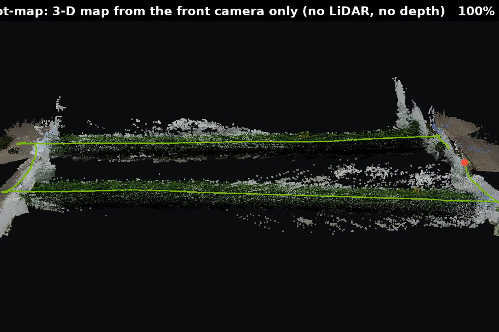

*Figure — lingbot-map: 3-D reconstruction from the front camera alone*

The server builds a 3-D model of the greenhouse two ways:

1. **ZED depth placed with cuVSLAM poses** (`scripts/zed_fuse.py`): each depth frame is back-projected with the ZED intrinsics (OpenCV convention) and transformed by cuVSLAM's camera-to-world pose, giving a 2.75 M-point map of both greenhouses with the arched roofs and plant rows in the right place — no ground truth involved. Figures `fig_cuvslam_map_top_and_section.png`, `fig_cuvslam_3d_chase.jpg`, `fig_cuvslam_3d_orbit.jpg`; video `cuvslam_3d.mp4`.
2. **lingbot-map** on the front camera alone (2 Hz, 1,296 frames): a feed-forward transformer that predicts camera poses and dense world points for a window of images and stitches windows in streaming mode. Figures `fig_lingbot_map_topdown.png`, `fig_lingbot_3d_orbit.jpg`; video `lingbot_3d.mp4`.

We benchmarked lingbot-map against other camera-only methods on the same front-camera sequence. Original scene, full route (RMSE after Sim(3)):

| Method | RMSE | Speed | GPU memory | Behaviour |
|---|---|---|---|---|
| lingbot-map | **1.22 m** | 12.1 fps | 15.5 GB | the only method that kept the two identical greenhouses apart |
| MASt3R-SLAM | 7.45 m | 8.4 fps | 62.7 GB | 1.07 m inside one aisle, lost the layout across the yard |
| MapAnything | 12.6 m | 5.0 fps | 45.5 GB | batch; the two aisles collapsed onto each other |
| VGGT | 13.1 m | 3.9 fps | 27.2 GB | batch; same failure |
| SLAM3R | 14.5 m | 9.2 fps | 30 GB | registered only the first ~380 frames |
| cuVSLAM mono | 15.8 m | 302 fps | 1.7 GB | mono at 2 Hz cannot initialise scale and motion |

On the Astra scene lingbot-map gives **1.06 / 0.87 / 1.95 m** at 11.6 fps and 17 GB (`fig_slam_paths_astra_scene.png`).

Why the feed-forward models fail here. Tunnel-09 and tunnel-10 are built from the same drawing and planted the same way, so the front camera sees nearly identical images in both. Batch methods (MapAnything, VGGT) solve all frames jointly and place visually identical views at the same place; MASt3R-SLAM and SLAM3R are incremental but lose track across the open yard, where the 2 Hz front camera gives few overlapping features and the scale is unobservable. Monocular methods can only recover scale up to a factor; lingbot-map's windowed streaming mode keeps the order of the frames and so keeps the two houses apart, but still needs a fitted scale. Stereo (12 cm baseline) or LiDAR fixes scale physically; that is why R181-S exists and why the LiDAR remains the primary localiser. Figure `fig_cuvslam_mono_failure.png`, `fig_mast3r_original_scene.jpg`.

### 3.5 Navigation architecture

Navigation is layered; the layers are independent and testable offline (`tests/`):

| Layer | Runs | Role |
|---|---|---|
| **MISSION** (`r1_nav/mission.py`, `commands.py`, `site_map.py`) | robot | Turns a goal into legs: path → enter → drive_in (tunnel-09) → path across the yard → enter → drive_out (tunnel-10) → path → dock. Goals must fit the confirmed aisle map and site map; anything else is rejected with a reason. Aisles wide enough to spin: drive in, turn, drive out (second camera pass); narrower: drive in, reverse out |
| **BOOK** aisle driver (`r1_nav/controller.py`, `sim/executor.py`) | robot, every tick | Keeps the robot centred between the two bed walls from the planar LiDAR; stops every 0.45 m (plant pitch), waits 0.5 s for the image to settle, fires the six side cameras, drives on. 161 stops on the farm route |
| **LOCALISATION** (§3.2–3.3) | robot | wheels + gyro + LiDAR scan matching; cuVSLAM on R181-S |
| **SAFETY** (`sim/executor.py`) | robot, every tick | LiDAR front stop; a scan-based stuck check (90th-percentile beam change < 3 cm over 5 s while the wheels are driven — the moving case is ≥ 0.70 m, blocked ≤ 0.002 m, so plant stops do not trigger it); spin-clearance check before turning; pose-vs-map disagreement stop |
| **HERMES** (§5) | server | Chooses goals (`survey_farm`, `revisit`, `return_to_dock`, `notify`); never wheel speeds |

Plant-stop logic: the stop pitch is the nominal plant spacing (0.45 m), and each stop's six frames carry the aisle metre from the localiser, so a plant that is off-pitch is still photographed by the neighbouring stops; the perception side then assigns each frame a 0.5 m strip of row (§4.2), so the uneven spacing is handled at counting time instead of at driving time.

---

### 3.6 Mapping by demonstration (teach mode)

The robot makes its own map. A person leads it once along every path it may use — dock, door, aisle, the yard to the
next house, home — while the recorder stores the 2-D LiDAR scans and the robot's own pose estimate at 10 Hz. A person
leads because a farm has ponds, an orchard, a road and soft ground that a robot must not learn by driving into them:
the led drive defines where the robot may go, and anything off that graph is refused. `scripts/teach_map.py` turns the
recording into the LiDAR prior map the localiser matches against (scans placed with the robot's own poses, 5 cm
cells, cells hit twice or more) and the site graph in the `r1_nav.site_map` schema: the dock, a door node wherever the
drive entered or left a house, edges along the taught path with their measured lengths, and each aisle's measured
length. The farmer names the houses and confirms the graph; from then on the robot is commanded by name
(`survey_house`, `go_to_house`, `survey_farm`) and plans its route on the graph it built.

On run 3 as the led drive (7 500 steps, 123 m) the script produced a 29 615-point map of both greenhouses and the yard
and a five-node graph — dock → tunnel-09 front door → tunnel-09 back door (42.2 m) → 12.8 m behind the houses →
tunnel-10 back door → tunnel-10 front door (42.1 m) → 14.0 m home — with both aisles measured at 41.5–41.6 m; the
graph loads, validates and routes. Re-localising the same 1 500 scans on the self-built map accepted every scan with
a fix error of 0.23 m RMSE, equal to the plan-derived map (0.23 m). Returns from the robot's own mast and electronics box (about 9 beams per scan, 0.3–0.6 m behind the LiDAR) are removed before mapping; left in, they draw a trace of the robot along the taught path and the map starts to behave like a painted line. The self-built map carries the pose error of the
drive that taught it (median fix 0.14 m against 0.03 m on the drawn plan); building it from cuVSLAM poses is the next
refinement (`docs/NEW_SITE_GUIDE.md`, `docs/evidence/10_teach_map_run3.json`).


*Figure — The farm as the robot recorded it on one led drive: 29 615 LiDAR points, no distances typed*


*Figure — The site graph the robot built from that drive: dock, doors and measured path lengths; anything off the graph is 'do not go'*

### 3.7 Relocalisation: put down anywhere

A robot placed somewhere other than its dock must find itself on the map it built. `sim/relocalize.py` searches every
place along the taught path (0.5 m spacing, both directions: 1 476 hypotheses on our farm), scores each by the fit of
the current LiDAR scan to the map, refines the best with the driving matcher, and reports ambiguity instead of a
guess when two far-apart places fit equally well — which, in two identical greenhouses, is the normal case inside the
aisles. Measured on run 3 from single scans at 40 random places: 8 found outright (median 5 cm), 30 flagged ambiguous,
2 wrong; 74 ms per scan on the Spark CPU. The tie is broken by vision: the current front image and a reference image
from the led drive at each candidate place are given to Nemotron 3.5 Super VL, which on 16 ambiguous scans decided 12
and was right in 10 (83 %), citing features a LiDAR cannot see — the lone tree through the far door, the grey block at
the base of the white wall, the irrigation line, the building beyond the house (`docs/evidence/12_vlm_place_check.jsonl`).
Motion prunes candidates that stop fitting the map but is not allowed to choose between symmetric rivals: left to the
LiDAR alone, driving on chose the wrong twin 9 times in 10 (`docs/evidence/13_relocalize_eval_run3.json`). The design
that follows is LiDAR for candidates, the camera for the decision, driving for confirmation; wiring it into the live
start-up of the robot is the next step.

Beside the path the map is thinner, so the led drive records look-around scans every 0.5 m (eight headings, 984 poses on
our farm) and the search covers every free cell (0.5 m grid × 24 headings, 101 148 hypotheses, 0.6 s). On 40 put-down
poses 1–3 m beside the path, with scans and front images rendered in the twin, the LiDAR candidates plus the Nemotron VL
tie-break against look-around reference images of matching heading give a correct pose and a planned route home
(rejoin the nearest graph node, then the normal route) in 25 of 40 (`docs/evidence/15_offpath_full_loop_summary.json`).

The test then continues through the whole mission from the believed pose, right or wrong: rejoin the taught path, aisle of tunnel-09, yard, aisle of tunnel-10, dock (`scripts/offpath_mission_eval.py`, synthetic scans on the self-built map). The believed place is checked against every scan, a whole-map search every 10 m keeps rivals alive, and a belief that stops fitting, an obstacle where the map says free, or a rival that fits clearly better over 2 m becomes a new anchor: the odometry history is re-placed, the plant records relabelled, the mission goals re-derived; before docking Nemotron VL compares the view with the dock and with the strongest rival. Near put-downs: survey complete with every stop covered 40 of 40, records right 39 of 40 (13 wrong starts, 12 corrected: 4 by the scans within 2 m, 8 by the camera at the dock). Ten further put-downs 4–8 m from the path, LiDAR guess alone to start: complete 10 of 10, right 9 of 10 (`docs/evidence/16_offpath_mission_survey.json`).

The route the led drive left behind is not needed afterwards. From its own map alone (`scripts/free_nav.py`) the robot marks the cells a LiDAR ray has crossed that lie farther than its half-width from any map point (space it has seen empty and can fit through), finds the wall direction and the plant aisles between parallel rows from the points, takes the place it was switched on as the dock, lets the agent's model (Nemotron 3 Super) decide the aisle order from that structure, and plans every path on the free grid when it is needed (A* with a clearance cost) - again whenever its belief changes or an obstacle that is not on the map appears (figure `media/gallery/30_free_nav_structure.png`). On the same 40 near and 10 far put-downs, with an obstacle that is not on the map dropped on the planned path in every case and HERMES reviewing the plan first, the survey was completed in 37 of 40 near cases (every row covered in 36, records right in 33; 12 of 13 wrong starts corrected) and 9 of 10 far cases (8 right); the obstacle was driven around in 39 of 50; HERMES approved 29 plans and changed 12; the order came from a Rural Postman solver on the robot (`docs/evidence/17_freenav_mission_survey.json`, figure `media/gallery/31_freenav_survey_each_case.png`).


*Figure — Put down, then do the whole survey: the path really driven in each of the 50 cases (green = knew where it was, orange = wrong belief, ○ = where the belief was corrected)*

## 4. Perception

### 4.1 RT-DETRv2 for fruit, plant bases and leaf anomalies

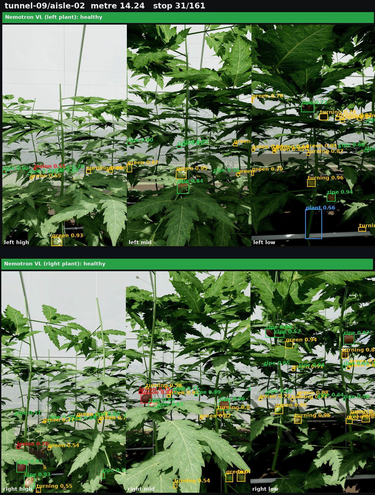

*Figure — RT-DETRv2 fruit grading on the six mast views of one plant stop*

**Model.** RT-DETRv2 (ResNet-18 backbone, `PekingU/rtdetr_v2_r18vd`, Apache-2.0) is a real-time detection transformer: a CNN backbone, an efficient hybrid encoder that mixes multi-scale features, and a transformer decoder with a fixed set of object queries that predicts boxes and classes directly, without anchors or non-maximum suppression. It is end-to-end (one forward pass, set prediction with Hungarian matching at training time) and small enough to run at camera rate on a Jetson or on a slice of an RTX PRO 6000. We fine-tuned it on our own data (`vision/train_rtdetr.py`).

**Classes and the grading rule.** `fruit_ripe` → PASS; `fruit_turning`, `fruit_green` → NOT READY; `fruit_lesion` → REJECT; `plant_base` (main stem 0–35 cm above the bed, one per plant, for counting); `leaf_chlorosis`, `leaf_spots` (anomaly regions). The grade is explainable: the detector's colour class is cross-checked with the mean hue inside the box, and a disagreement is reported instead of silently fixed. Wilting, stunting and defoliation are whole-plant shapes that a box detector at 1 m cannot represent; they are left to the VLM.

**Training data.** `rtdetr_v2_mixed` was trained on **synthetic renders mixed with public real photographs**: `vision_data/synth_v1` (Blender renders of random tomato rows from the Tomato-Assets-V1 library at the three mast heights, 576×1024, with boxes taken from the renderer's object-index and anomaly-tissue passes — nobody draws boxes), plus the public AgRob and PlantDoc sets converted to our classes (`vision/tools/convert_public.py`); **n_train = 1,942**. Validation is split by rendered scene so no validation row is seen in training. Mild leaf spots are not labelled because they are invisible at mast distance.

**Counting without double counting.** Neighbouring stops overlap and the low/mid/high cameras overlap vertically. Each side frame therefore *owns* the 0.5 m strip of row centred on its capture metre and the height band of its camera (bands split halfway between camera heights: low < 1.00 m < mid < 1.43 m < high). A fruit is counted by the frame that owns the strip and band it falls in; its position is estimated from the box centre, the camera's field of view (40° × 65°) and the 0.95 m distance to the near row (`vision/detector.py`).

**Results, Astra scene, 161 stops × 6 cameras = 966 side images (threshold 0.5):**

| Aisle | Ripe (PASS) | Not ready | Lesion (REJECT) |
|---|---|---|---|
| tunnel-09 | 1,780 | 2,242 | 53 |
| tunnel-10 | 1,769 | 2,242 | 32 |

Plant count from `plant_base`: 16 and 29 plants of ~168 per aisle — not usable on this scene, because the beds hide the stem base from the fixed cameras; counting should use the LiDAR stem detector (§3.2) instead. Disease: see §4.4. Figures `fig_side_ai_harvest.jpg`, `fig_side_ai_chlorosis_stop26.jpg`; videos `det_*.mp4`, `side_ai_*.mp4` (one per camera and per category: harvest, plant count and disease are never mixed in one output).

### 4.2 Nemotron 3.5 Super VL: one request per plant stop

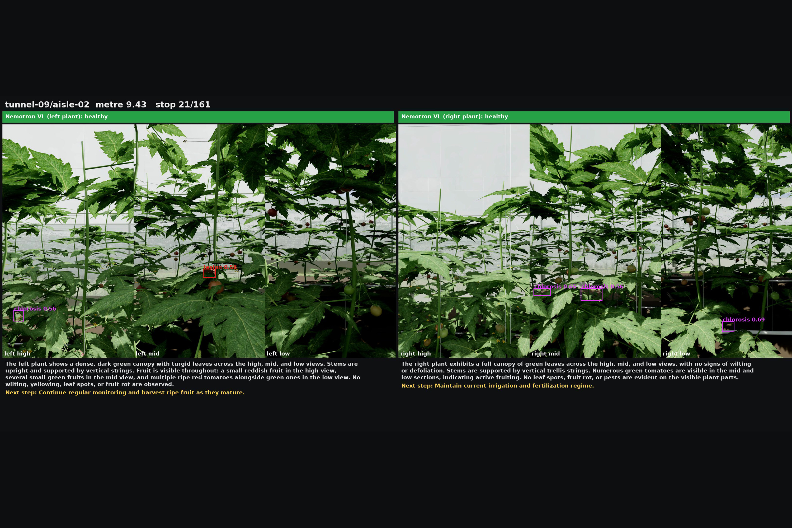

*Figure — One plant stop: six views, detector boxes, Nemotron 3.5 Super VL verdict, description and next step*

A vision-language model is better than a box detector at the questions a farmer asks: *is this plant healthy, what is wrong, what should I do?* NVIDIA Nemotron 3.5 Super VL (hosted on Nebius Token Factory) is given **all six views of a stop in one message** — left high/mid/low is the plant in the left row, right high/mid/low the plant in the right row — so it sees each plant top to bottom and the number of calls equals the number of stops, not stops × cameras (`scripts/vlm_stop.py`). The prompt asks for a status per plant, a list of issues with confidence, a 3–5 sentence agronomist-style description and a next step; the answer is parsed as JSON and checked against the hidden anomaly plants.

Run on the Astra scene: 161 requests, 322 plants judged, 1.25 M tokens, ~8 s per request with four workers. Typical description: *"upper-canopy yellowing, lower leaves green; stems and fruit look normal; likely nutrient issue — check soil nitrogen and irrigation uniformity."* Health and harvest are always reported on separate pages so that a sick plant is never mistaken for a ripe one.

### 4.3 Cosmos Reason 2 for the front camera

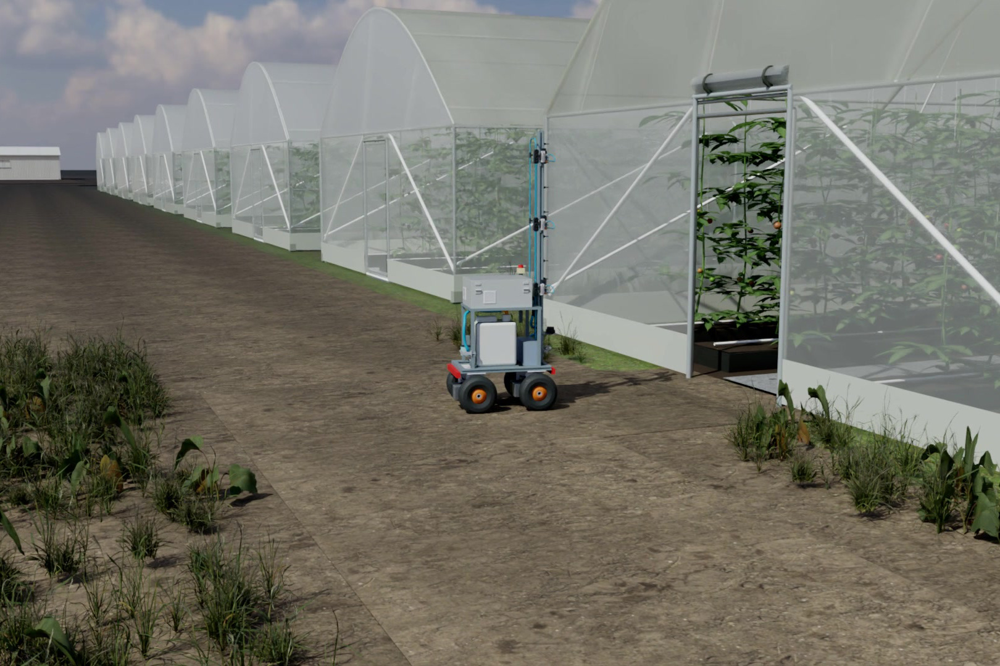

*Figure — Between greenhouses: the front camera is sent to Cosmos Reason on events*

Cosmos Reason 2 (8B, served with vLLM on an RTX PRO 6000) is the robot's situational reasoner, not its plant inspector. It is asked about the **front camera** at the moments the navigation design calls "open your eyes": every change of leg (leaving the dock, a doorway, crossing the yard), every 10 s of driving, and whenever SAFETY stops the robot. The prompt states where the robot is and what it is about to do and asks for a short description, whether the path is clear, hazards, and one of continue / slow_down / stop / ask_human as JSON (`scripts/cosmos_front.py`). HERMES uses the answer to wait (a person, an animal) or to notify the farmer (a hose, a cart, a fallen plant).

Measured: 83 checks on the original scene and 68 on the Astra scene (1,501 and 1,296 front frames). When the model answers in JSON its round trip is about **1.5 s**; when it narrates to the 2,048-token limit it takes about **25 s** and the JSON has to be salvaged from the prose (the parser strips reasoning tags and code fences and recovers the `scene` and `recommendation` fields from a truncated answer). In the Astra-scene run 9 of 68 answers parsed cleanly, all "continue"; the scene descriptions were accurate (doorway, aisle, planters, clear path). A multi-image per-stop request (the §4.2 pattern) is not supported by this model and failed on all 322 plants, which confirms the division of labour: Cosmos for the front camera and situations, Nemotron VL for the plants.

### 4.4 Disease screening: detector + VLM

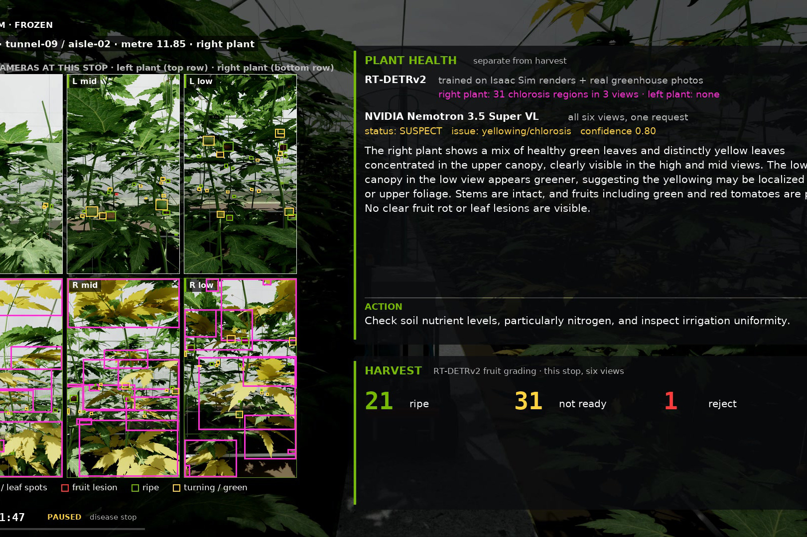

*Figure — Plant-health card at a sick plant: boxes, Nemotron's description and the recommended action, kept separate from harvest*

Nine anomaly plants are hidden in the 672. Detection is scored per plant: a plant counts as found when a flag lands within 0.7 m of its row position.

| Anomaly (count) | RT-DETR | Nemotron VL (6 views/stop) | Either |
|---|---|---|---|
| Chlorosis (2) | 2/2 | 2/2 | 2/2 |
| Fruit lesion (2) | 2/2 | 0/2 | 2/2 |
| Leaf spots (3) | 0/3 | 2/3 | 2/3 |
| Wilting (1) | n/a | 0/1 | 0/1 |
| Defoliation (1) | n/a | 0/1 | 0/1 |
| **Total** | 4/7 detectable | 4/9 | **6/9** |
| False alarms | 568 boxes away from any anomaly plant | 12 plants | — |

The two models are complementary: the detector sees fruit lesions and chlorosis but over-flags chlorosis (it was trained on synthetic chlorosis that is stronger than this scene's); the VLM sees leaf spots and writes the explanation but misses lesions on fruit. Wilting and defoliation are whole-plant shapes that the side cameras at 1 m cannot capture; a farther view (CCTV or the front camera) is the fix. The VLM's 12 false flags are what HERMES's revisit step is for (§5).

In the live run 3 on the original scene, where every side image went to both eyes individually (978 images → Cosmos Reason 2 + Nemotron VL per image), 52 suspect shots found 4/9 anomaly plants with 37 shots flagged away from any anomaly; the per-stop six-view design above replaced it because it halves the calls and gives the model the whole plant.

---

## 5. The agent: HERMES

**Who plans what.** HERMES plans the *mission*: which houses to survey today and in what order, which plant to go
back to, when to come home, whom to tell. The *route* — the actual path from where the robot is to the door of the
house it was sent to — is planned by the robot itself on the site graph (`r1_nav/site_map.py` finds the shortest
confirmed path; `r1_nav/commands.py` turns it into legs), and the *driving* along that route is the robot's
navigation stack alone. HERMES never sees a coordinate or a wheel; it names a destination, and the robot gets there.


HERMES is the agent runtime: Hermes Agent with our `r1-robot-control` skill, plus a deterministic fallback loop (`agent/brain_loop.py`) that executes the same decision procedure so that the robot API cannot tell the two apart. It runs **NVIDIA Nemotron 3 Super (120B-A12B)** on Nebius Token Factory for reasoning text and for the farmer's report.

**What ran where.** On the recorded run 3 the goal decisions were produced by the deterministic fallback loop
(`agent/brain_loop.py`, the skill's decision procedure in code) with Nemotron writing the explanations and the report.
Hermes Agent itself was then run live against the hub with the `r1-robot-control` skill and Nemotron 3 Super on
Token Factory: in 29 s and 14 tool calls it checked health and status, commanded `survey_house tunnel-09` (accepted;
the hub reported two too-narrow aisles skipped), read the findings, judged that no revisit was needed, and sent
`return_to_dock`, stating its reason for each command (`docs/evidence/11_hermes_agent_live_nemotron.log`).

Principles:
- **Goals, never wheels.** HERMES sends `survey_farm`, `survey_house`, `revisit <aisle> <metre>`, `go_to_house`, `return_to_dock`, `notify`. The robot validates every command against its confirmed aisle and site maps (`r1_nav/commands.py`) and rejects what does not fit, with a reason. A human confirms every map before the robot uses it.
- **Verify before alarming.** Disease flags are clustered within 1 m; after the survey the strongest clusters are revisited and the six revisit shots are judged again; a flag is cleared only when all six come back healthy. On run 3 HERMES ordered revisits at tunnel-09 metre 0 and 1.4 (chlorosis flags); both came back healthy and the two false alarms never reached the farmer. On an earlier run with a stronger lesion the revisit confirmed it (early blight 0.89–0.99).
- **Situations.** When SAFETY stops the robot, the front frame goes to Cosmos Reason (§4.3) and HERMES waits for people and animals or notifies the farmer for anything that will not move by itself.

Interfaces (`agent/robot_api.py`, `docs/INTERFACES.md`): from HERMES `POST /command`, `GET /status`, `GET /findings`, `GET /map`; from the robot `GET /next_command`, `POST /status`, `POST /frame` (multipart: JSON meta + JPEG), `POST /run_complete`; for anyone `GET /health`, `GET /run_status?run=<name>`. The dashboard (`dashboard/`) shows the live map, finding pins, the seven camera views and the HERMES decision feed, with *Plant health* and *Harvest* as separate panels.

---

## 6. Cloud pipeline and system integration

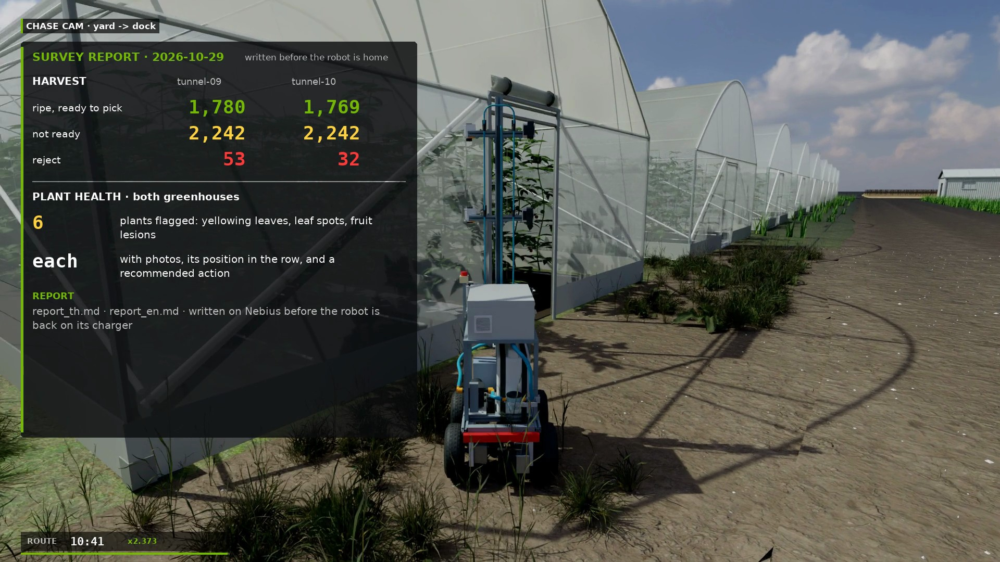

*Figure — The farmer's report: ripe / not ready / reject per greenhouse and the flagged plants with photos, position and next step*

### 6.1 One system

```
robot (Isaac twin now, Jetson later)                   Nebius server (RTX PRO 6000 VM)
 survey ─ frames ───────────────────────▶ hub /frame   (RT-DETR + VLM eyes; HERMES goals back via /next_command)
 survey done ─ rsync run dir + /run_complete ─▶ run_complete.json ─▶ pipeline watcher
                                              detect ▸ vlm_stops ▸ lidar_map ▸ cuvslam ▸ lingbot ▸ cosmos_front ▸ report
                                              <run>/analysis/report.json · report_th.md · report_en.md
```

The run directory written by the robot (`steps.jsonl` 30 Hz pose and leg, `frames.jsonl` one row per captured image with aisle metre, `events.jsonl`, `side/`, `front/`, optional `zed/` in EuRoC layout) is the contract between the two halves. At the end of a survey the robot rsyncs it to the server and posts `/run_complete` (`sim/cloud_link.py`, or `scripts/robot_upload_run.py` for an already recorded run). The hub writes `run_complete.json`; the watcher (`python3 -m cloud.pipeline watch`) picks it up and runs the steps:

| Step | Input | Output | Skips when |
|---|---|---|---|
| detect | side images | per-camera findings, harvest / plant count / disease summaries, annotated videos | detector weights missing |
| vlm_stops | six views per stop | per-plant description + action, score vs ground truth | no Token Factory key |
| lidar_map | steps.jsonl | 2-D LiDAR map video + PNG, odometry vs truth | — |
| cuvslam | zed/ | trajectory per mode, ATE, map PLY | no cuvslam wheel |
| lingbot | front/ | poses, point cloud, timing | no docker image |
| cosmos_front | front/ + steps | situation checks with latency | no Cosmos endpoint |
| report | everything above | `report.json`, `report_th.md`, `report_en.md` (Nemotron text, or a template without a key) | — |

Steps are idempotent and isolated: a finished step leaves `<step>.done`, a failed optional step leaves `<step>.error` and the rest still run, `pipeline.lock` stops two runners from working on the same run, `--force` re-runs. 114 offline tests cover the config, markers, skips, the hub's `/run_complete` and the watcher (`tests/test_pipeline.py` and others). Everything on the server is stateless per run: a hundred robots are a hundred upload queues into the same pipeline.

### 6.2 Install and run from a fresh clone

`docs/INSTALL.md` describes both halves: `deploy/nebius/install_cloud.sh` (apt packages, a venv with torch and the requirements, offline tests, optional `--cuvslam` / `--lingbot`, `--service` for the systemd unit) and `deploy/robot/install_robot.sh` (venv, requirements, robot-side tests). Keys live only in `deploy/nebius/.env`. The fine-tuned detector weights are not in the repository and are available from the author on request.

Clean-clone verification at the time of writing: the **robot side** was installed from a fresh clone on an ARM64 machine (the same architecture as the Jetson) and passed its 50 offline tests; the first attempt found a missing dependency (scipy, used by the LiDAR odometry and scan localiser), which is exactly what such a test is for and has been fixed. The **cloud side** clean install on a fresh Nebius checkout, followed by the robot hand-off of run 3 and a complete pipeline run, is being verified at the time of writing; the pipeline itself has run end to end on run 3 (detect, lidar_map, report) on the development machine.

### 6.3 Compute and cost

- Render farm: 16 × RTX PRO 6000 for about two hours for the Astra re-render; about 46 GPU-hours on 29 Oct in total (roughly US$45–85 at list prices).
- Token Factory: about 2.5 M tokens for all Nemotron VL runs (cents to a few dollars); report text and HERMES reasoning are small.
- cuVSLAM: 12 s for 6,476 stereo frames on one GPU; lingbot-map: 151 s wall for 1,296 frames; RT-DETR on 966 images: minutes.
- Cloud SLAM from drone video (MapAnything / VGGT) runs as a Nebius Serverless Job on an H200 (55 s for 200 frames) from the Nebius Container Registry (`cloud/mapping/`).

---

## 7. Evaluation methodology

- **Ground truth for plants.** The nine anomaly plants are placed by the scene script and their positions recorded in `ground_truth_plants.json`; a flag is matched to a plant within 0.7 m along the row (`PIPELINE_MATCH_M`). Scores are per plant, per category (chlorosis, leaf spots, fruit lesion, wilting, defoliation), and per model, so that detector and VLM can be compared on the same table. False alarms are flags farther than 0.7 m from any anomaly plant.
- **Ground truth for the pose.** The simulator's pose is recorded (`gt_scene_pose` in `steps.jsonl`) but never read by the robot code; it is used only afterwards to score the localisers.
- **Trajectory error.** ATE after a Sim(3) alignment (Umeyama) for all SLAM methods, with the fitted scale reported; for the robot's own LiDAR localiser no alignment is applied (it is already in the farm frame). RMSE, median and maximum are all reported because a map with one bad corner and a map that is uniformly off need different fixes.
- **Harvest counts.** Counted once per strip and height band (§4.1); the scene's true fruit counts per class are available from the asset instances and will be used for a count-level accuracy once the plant-base/strip assignment is validated — the counts in §4.1 are detector output, still to be compared to a per-fruit truth.
- **Why plant counting failed.** The `plant_base` class is defined 0–35 cm above the bed; on the Astra scene the bed edge hides that region from all three camera heights, so there is nothing to detect. The LiDAR sees every stem as a short arc at 0.55 m height and is the better counter.
- **Tokens and cost** are logged per request (Nemotron VL returns usage; Cosmos latency is measured per call).
- **Render budget** (§6.3) is recorded because it is the real cost of a sim-based evaluation: each full-route re-render with all cameras is about 32 GPU-hours at 32 spp.

---

## 8. Open points and future work

1. **Every number is from simulation.** The figures come from the Isaac twin; images are noise-free and perfectly calibrated. cuVSLAM's 6 cm and the detector's precision will be worse with real cameras, condensation on the film and real plants.
2. **Jetson: installed and benchmarked, the live loop is next.** The robot side installs and passes its tests on a real Jetson Orin Nano and cuVSLAM runs there at 188 fps (`docs/evidence/04`, `09`); the live sensor drivers (LiDAR, ZED, wheels) and the relocalisation start-up are the remaining wiring.
3. **Disease recall.** 6/9 combined; wilting and defoliation are not detected. Planned: a whole-plant view (front camera or a CCTV-style camera at the aisle end) judged by the VLM, and real-photo fine-tuning of the detector.
4. **Plant counting** must move to the LiDAR stem detector.
5. **Cosmos prompt discipline.** Half the answers ran to the token limit; a stricter system prompt, a lower `max_tokens` and a JSON schema (guided decoding in vLLM) should bring every answer to ~1.5 s.
6. **Scene fidelity.** Doors, colliders and plant spacing are modelled, not surveyed; the real aisles (two of tunnel-09's three are narrower than the robot plus margin) will constrain the mission planner.
7. **Learned driving.** The aisle driver is engineered (LiDAR centring + stops). A learned world-model controller such as TD-MPC2 (implicit latent world model with MPPI planning; one hyper-parameter set across 104 continuous-control tasks) is a candidate for the yard crossing and door passages, trained in the same twin; the engineered driver would remain the safety envelope.
8. **Watering and intervention**: pump, tank and nozzles are designed and the API drafted; not built.
9. **Real-farm trials** are the next milestone: measure the side aisles on site, run the physical R1, fine-tune the eyes on our own frames.
10. **Live ground check before field trials.** A 2-D LiDAR sees neither a drop-off nor still water; before the robot drives on its own in the field, a layer on the Jetson (ZED 2i depth drop-off / no-depth test, plus a small real-time segmentation model at about 2 frames per second, ~5 % of the GPU) must be able to veto every forward command: stop, mark the place, plan again. The same pass labels canopy, stems, fruit and yellowing leaves as a plant layer of the map; fine grading stays with the detector at the stops and the VLM.

---

## 9. Reproducibility

- **Repository:** https://github.com/TheFrontier-AI/RoboScout-Greenhouse (Apache-2.0). Install and run: `docs/INSTALL.md`; pipeline details: `docs/PIPELINE.md`; interfaces: `docs/INTERFACES.md`.
- **Weights.** RT-DETRv2 base and lingbot-map are public. **The fine-tuned RT-DETRv2 weights (`vision_runs/rtdetr_v2_mixed/best`) are available from the author on request**; they are not in the repository. Nemotron 3 / 3.5 Super VL are used through Nebius Token Factory; Cosmos Reason 2 is gated on Hugging Face (accept the licence, set `HF_TOKEN`).
- **Licences.** Project code Apache-2.0; RT-DETRv2 Apache-2.0; lingbot-map Apache-2.0; cuVSLAM under the NVIDIA community licence; MapAnything, VGGT, MASt3R-SLAM and SLAM3R under their research licences (benchmark only); Isaac Sim under NVIDIA's licence.
- **Data.** Run 3 recording (`r1_runs/farm_2026-10-29/vm_runs/farm_full3/rec`, 5.8 GB: steps/frames/events, 978 side PNGs, 1,501 front JPEGs) and the Astra re-render (`render_v2_astra_scene/raw`, 27 GB, all cameras) are kept by the author; the hand-off test in §6.2 uses run 3 as the robot's recording.
- **Tests.** `python3 -m pytest -q` — 114 offline tests, no GPU or network.

---

## 10. Appendix

### A. All numbers in one place

| Quantity | Value | Scene / source |
|---|---|---|
| Route length, run 3 | 123 m, 12.5 min sim time, 7,500 control steps, 161 plant stops, 2 revisits, no collision | original, `farm_full3/rec/steps.jsonl` |
| Robot localiser (wheels + gyro + LiDAR) | RMSE 0.23 m, median 0.14, max 0.50; 7,497/7,498 matches accepted | original |
| Robot localiser on the re-rendered route | 0.25 / 0.18 / 0.49 m | Astra |
| cuVSLAM stereo | 0.064 / 0.041 / 0.16 m, scale 1.003, 526 fps, ~1.7 GB | Astra, 111 m, 6,476 frames |
| cuVSLAM stereo + IMU | 0.22 / 0.21 / 0.34 m, 422 fps | Astra |
| cuVSLAM RGB-D | 13.8 m full route (6 mm on 30 s), 243 fps | Astra |
| cuVSLAM 30 s segment (stereo / inertial / RGB-D) | 3.8 / 4.2 / 6.4 mm, 1,308 / 646 / 507 fps | Astra, tunnel-09 |
| lingbot-map | 1.06 / 0.87 / 1.95 m, 11.6 fps, 17 GB (1.22 m, 12.1 fps, 15.5 GB) | Astra (original) |
| MASt3R-SLAM / MapAnything / VGGT / SLAM3R / cuVSLAM mono | 7.45 / 12.6 / 13.1 / 14.5 / 15.8 m | original, 1,296 front frames at 2 Hz |
| cuVSLAM + ZED dense map | 2.75 M points | Astra |
| Harvest, tunnel-09 | 1,780 ripe / 2,242 not ready / 53 reject | Astra, RT-DETR thr 0.5 |
| Harvest, tunnel-10 | 1,769 / 2,242 / 32 | Astra |
| Plant count (plant_base) | 16 and 29 of ~168 per aisle | Astra |
| Disease, RT-DETR | 4/7 detectable; 568 false boxes | Astra |
| Disease, Nemotron VL | 4/9; 12 false plants; 161 requests, 322 plants, 1.25 M tokens, ~8 s/request | Astra |
| Disease, combined | 6/9 (wilting, defoliation missed) | Astra |
| Live run 3 two-eye screen | 978 images, 52 suspect shots, 4/9 plants, 37 false shots; 2 revisits, both cleared | original |
| Cosmos Reason 2 front checks | 83 (original), 68 (Astra); ~1.5 s JSON answers, ~25 s when run to 2,048 tokens; 9/68 clean JSON on Astra | both |
| Detector training set | 1,942 images: synthetic renders + AgRob + PlantDoc | — |
| Re-render | ~25,000 frames, 16 × RTX PRO 6000, ~2 h; 32 spp path tracing | Astra |
| Compute, 29 Oct | ~46 GPU-hours; ~2.5 M Token Factory tokens | — |
| Tests | 114 offline (50 on the robot-side subset) | repo |

### B. Figures and videos

Figures in `docs/media/figures/`: `fig_cctv7_overview.jpg`, `fig_chase_door_t09.jpg`, `fig_chase_yard.jpg`, `fig_storyboard_cctv.jpg`, `fig_storyboard_bystander.jpg`, `fig_r181s_zed_stereo_depth.jpg`, `fig_run3_route_vs_estimate.png`, `fig_lidar_2d_scan.png`, `fig_lidar_slam_map_astra_scene.png`, `fig_slam_paths_astra_scene.png`, `fig_cuvslam_map_top_and_section.png`, `fig_cuvslam_3d_chase.jpg`, `fig_cuvslam_3d_orbit.jpg`, `fig_lingbot_map_topdown.png`, `fig_lingbot_3d_orbit.jpg`, `fig_mast3r_original_scene.jpg`, `fig_cuvslam_mono_failure.png`, `fig_side_ai_chlorosis_stop26.jpg`, `fig_side_ai_harvest.jpg`, `fig_astra_doors.jpg`; cover GIF `docs/media/r1_cctv_tunnel09.gif`.

Videos (raw renders, no cuts) in `TheFarm/r1_runs/farm_2026-10-29/render_v2_astra_scene/videos/`: `chase.mp4`, `front.mp4`, `side_*.mp4`, `det_*.mp4`, `side_ai_*.mp4`, `zed_left_540p.mp4`, `zed_right.mp4`, `zed_depth.mp4`, `lidar.mp4`, `slam_map.mp4`, `cuvslam_3d.mp4`, `lingbot_3d.mp4`, `shots/cctv*_*.mp4`, `shots/person*_*.mp4`. Demo film (3 min): `docs/demo/robofarm_demo.mp4`. Interactive 3-D maps: https://claude.ai/artifact/CExpeKcE3DEmoCgeUKftwk; SLAM benchmark page: https://claude.ai/artifact/N2YRTHArKStwgH7mWNpigM.

### C. Glossary

- **ATE** — absolute trajectory error: distance between estimated and true positions after alignment; reported as RMSE / median / max.
- **Sim(3)** — similarity transform (rotation, translation, one scale) used to align a trajectory whose scale is unknown; the fitted scale shows whether a method is metric.
- **ICP** — iterative closest point: aligns two point sets by alternating nearest-neighbour matching and least-squares rigid fitting.
- **Scan-to-map / scan-to-keyframe** — ICP of a LiDAR scan against a prior map / against a recent reference scan.
- **cuVSLAM** — NVIDIA's GPU visual SLAM library (stereo, stereo-inertial, RGB-D, mono).
- **lingbot-map, MapAnything, VGGT, MASt3R-SLAM, SLAM3R** — feed-forward or hybrid neural 3-D reconstruction / SLAM methods from images.
- **RT-DETRv2** — real-time detection transformer (set prediction, no NMS).
- **VLM** — vision-language model (Nemotron 3.5 Super VL, Cosmos Reason 2).
- **BOOK / SAFETY / MISSION / HERMES** — the navigation layers: aisle driver on the farm map; LiDAR-based protective stops; goal-to-legs expansion; the goal-level agent on the server.
- **Run directory** — the robot's recording of one survey (`steps.jsonl`, `frames.jsonl`, `events.jsonl`, `side/`, `front/`, `zed/`).
- **Token Factory** — Nebius's hosted inference API (OpenAI-compatible) used for the Nemotron models.
