# RoboFarm gallery

Pictures taken from the demo film are the full 1920×1080 frame (01, 02, 04, 11-14); the others are 3:2; all ≤ 2 MB. Renders are from the NVIDIA Isaac Sim digital twin of our farm (Astra scene) unless marked *real photo*.

| # | Image | Caption |
|---|---|---|
| 01 |  | Digital twin of our tomato farm in NVIDIA Isaac Sim — CCTV view as R1 leaves its dock |
| 02 |  | R1 driving itself down tunnel-09, stopping at every plant — chase camera |
| 03 | 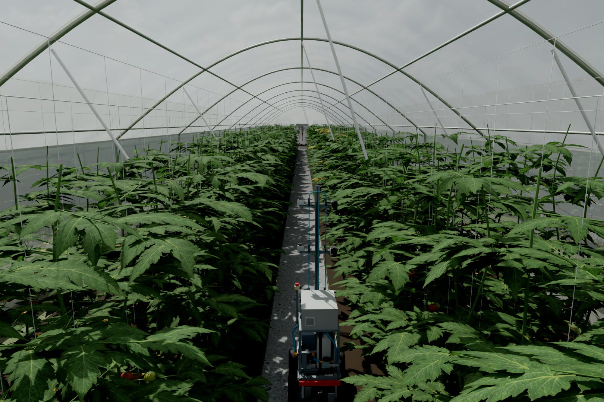 | Greenhouse CCTV: R1 working the aisle, six mast cameras capturing each plant from both sides |
| 04 |  | Bystander view: R1 crossing the yard between greenhouses, Cosmos Reason watching the front camera |
| 05 | 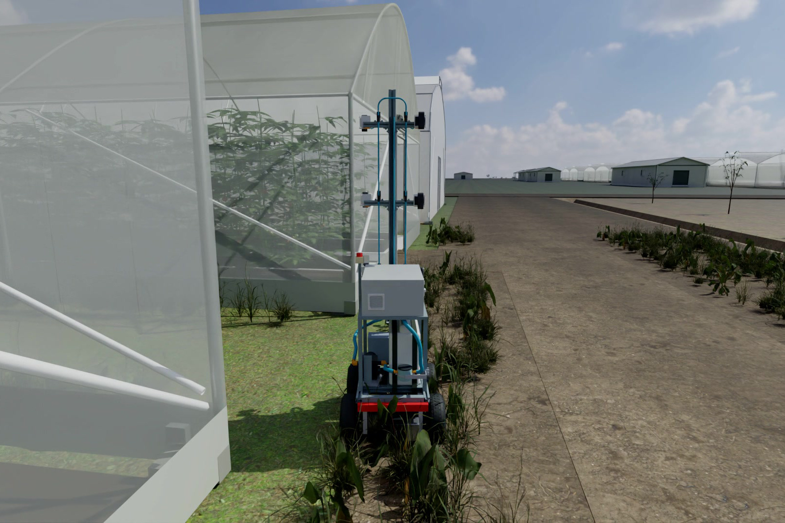 | Out the back door and across the yard to tunnel-10 — the full route is driven, not scripted |
| 06 | 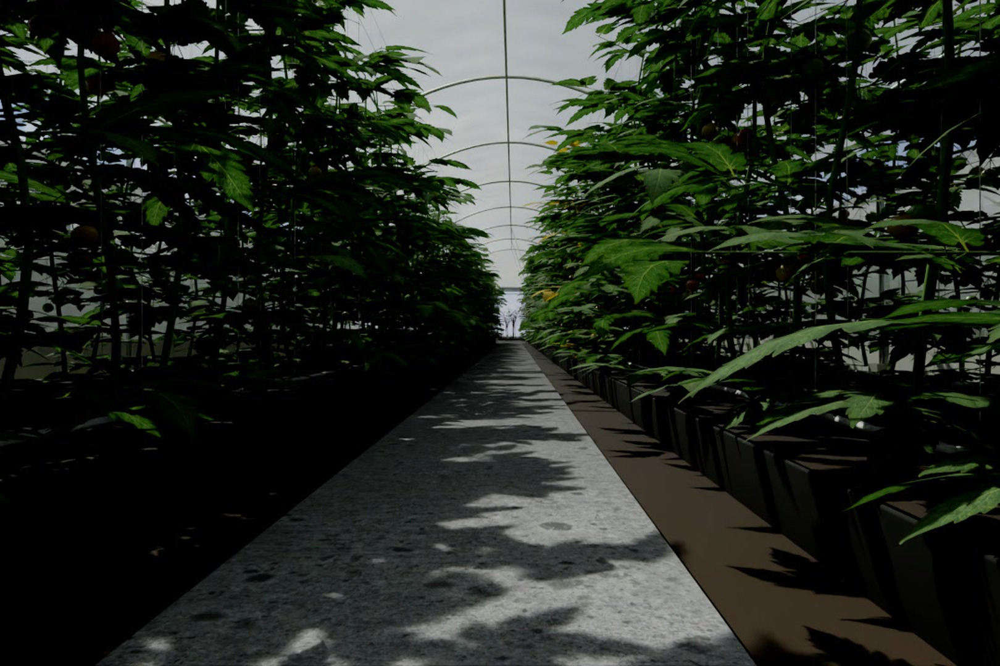 | R1 front camera: the aisle as the robot sees it; this feed goes to NVIDIA Cosmos Reason on events |
| 07 |  | Plant stop 21/161: six views, RT-DETR boxes, NVIDIA Nemotron 3.5 Super VL verdict and next step |
| 08 |  | RT-DETRv2 fine-tuned on Isaac Sim renders + real greenhouse photos: every fruit graded ripe / not ready / reject |
| 09 |  | R181-S: ZED 2i stereo depth from the robot's own camera, used for cuVSLAM and the 3-D map |
| 10 |  | 2-D LiDAR scan in the robot frame — matched against the farm map for localisation, no markers or tags |
| 11 |  | 3-D map of the greenhouse: ZED stereo depth placed with NVIDIA cuVSLAM poses, built on Nebius GPUs |
| 12 |  | lingbot-map: a second 3-D reconstruction from the front camera alone, run as a Nebius GPU job |
| 13 |  | Plant-health card at a sick plant: RT-DETR boxes, Nemotron's description, recommended action — separate from harvest |
| 14 |  | The farmer's report: ripe / not ready / reject per greenhouse, flagged plants with photos, location and next step |
| 15 |  | R180 assembly overview from our CAD model — built around locally available components |
| 16 | 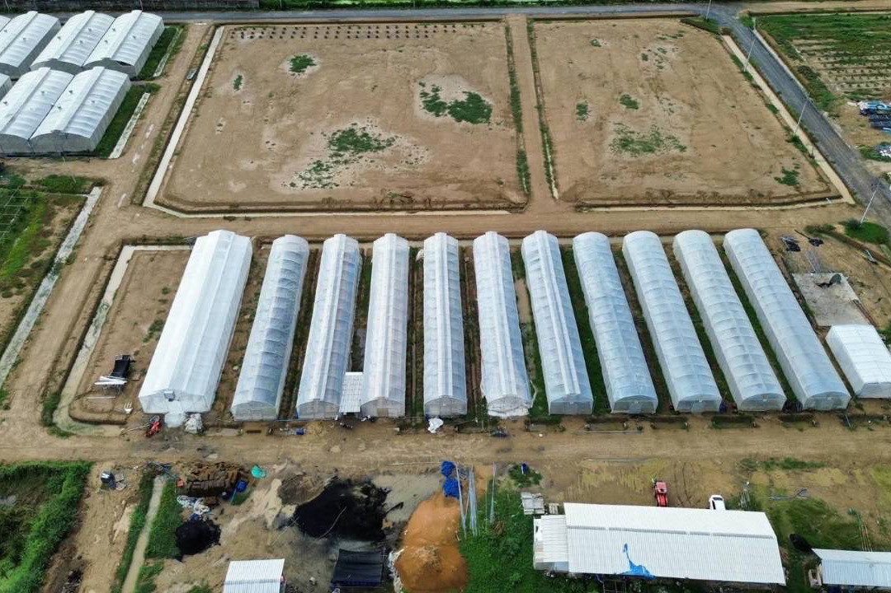 | *Real photo* — the row of tunnel greenhouses the digital twin was built from |
| 18 | 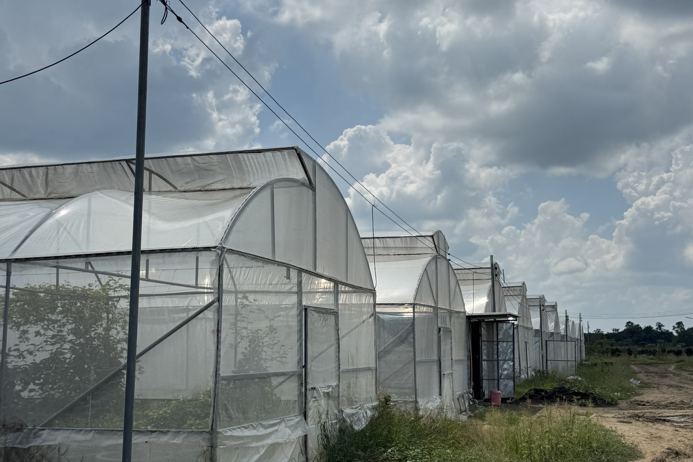 | *Real photo* — the tunnel greenhouses from outside, matched in the Isaac Sim twin |
| 19 |  | Farm layout of the twin (Blender layout model, scene V16, 25 Oct): greenhouses, ponds, orchard plots, sheds — the current Isaac Sim scene is shown in images 01–06 |
| 20 | 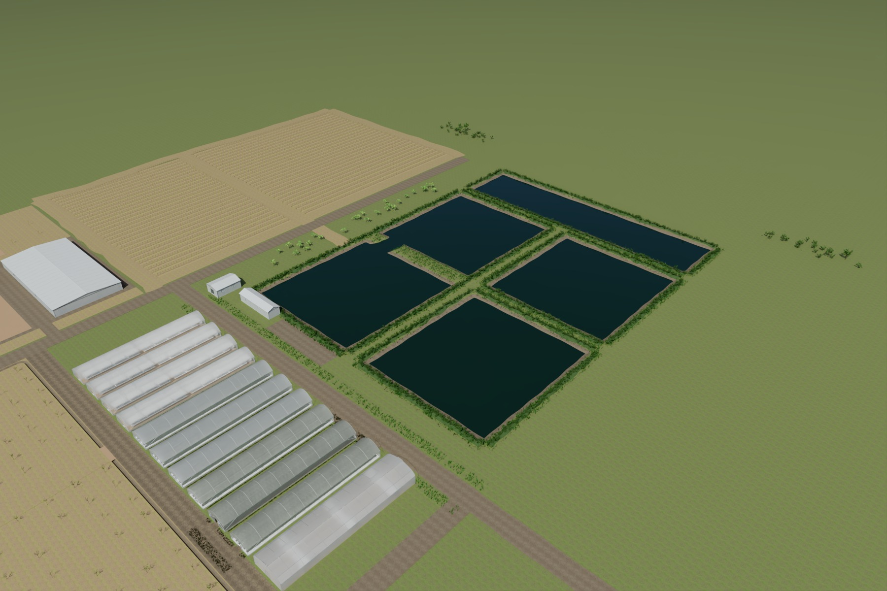 | Aerial of the greenhouse block and the four ponds (Blender layout model, scene V16) |
| 21 | 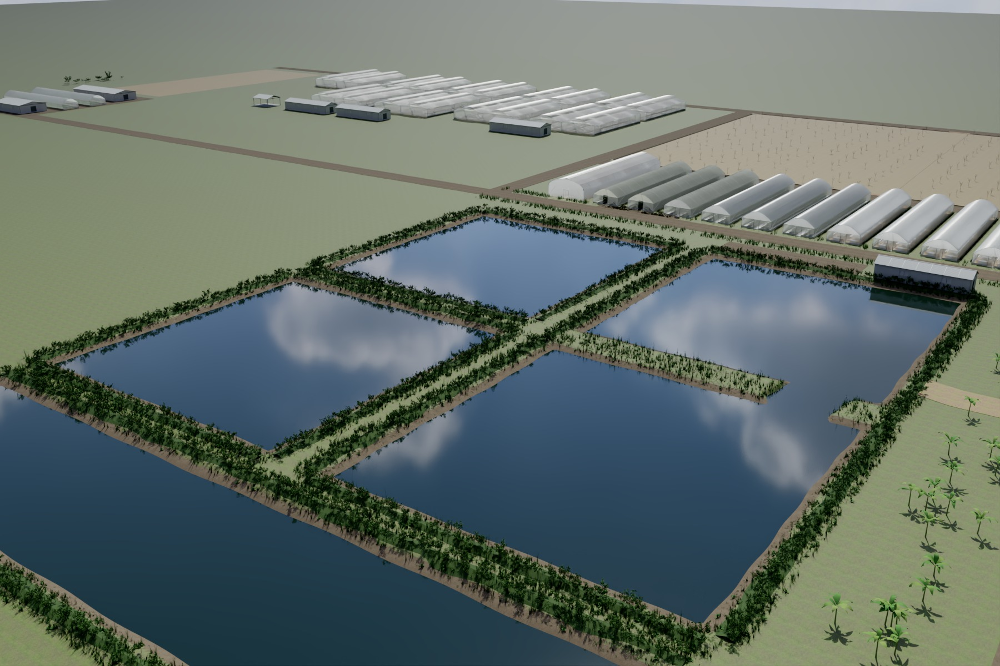 | Ponds and the tunnel greenhouses (Blender layout model, scene V16) |
| 24 |  | Mapping by demonstration: the farm as the robot recorded it on one taught drive — map, dock and doors built by the robot, no distances typed |
| 25 |  | The site graph the robot built from the led drive — dock, doors and measured path lengths on its own LiDAR map; anything off the graph is 'do not go' |
| 26 |  | Put down anywhere: 60 random points on run 3 — where one LiDAR scan finds the place (green), where it is ambiguous between the twin houses (yellow), where it is wrong (magenta), and the camera's tie-break (blue correct / red wrong) |
| 28 |  | Put down, then do the whole survey on the taught route: six of the 50 cases as really driven, three that knew where they were and three that started with a wrong guess; ● = start, blue = the path driven, ○ = where the belief was corrected, ★ = dock |
| 30 | 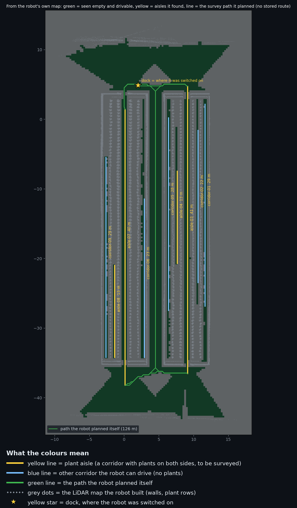 | No stored route: from its own LiDAR map the robot marks the space it has seen empty and can fit through (green), finds the plant aisles between parallel rows (yellow) and plans the survey path itself (A* with a clearance cost); the dock is where it was switched on |
| 31 | 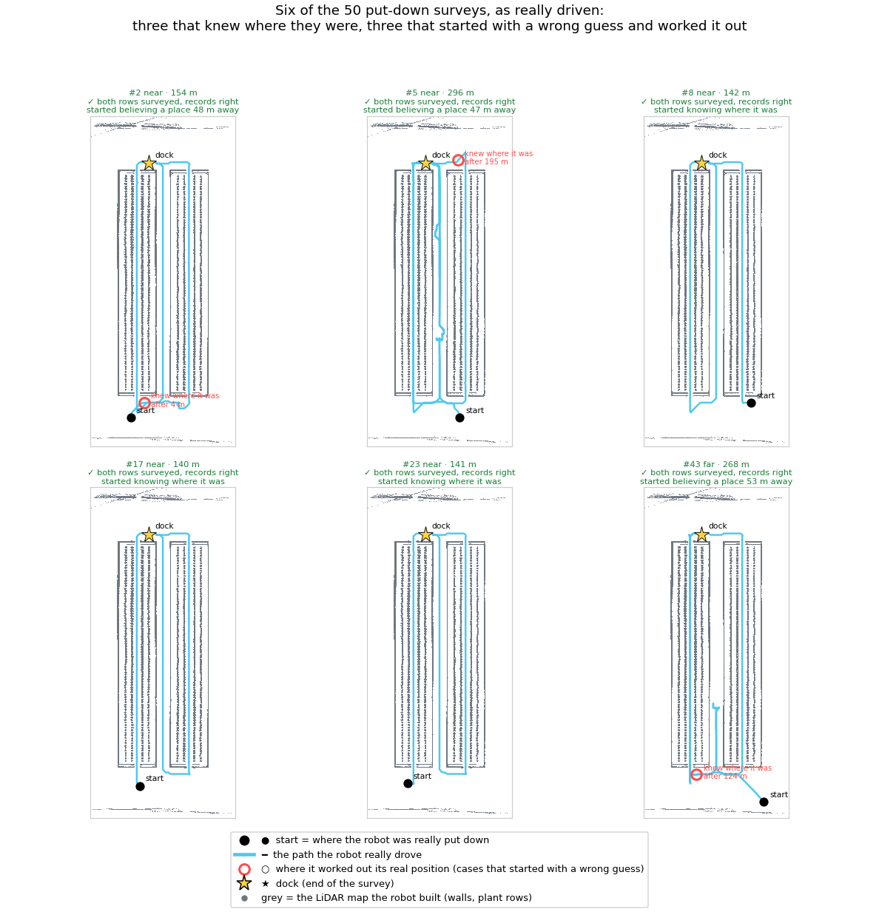 | Survey with no stored route: six of the 50 put-downs as really driven, three that knew where they were from the start and three that started with a wrong guess and worked it out; grey = the LiDAR map the robot built, ● = start, blue = the path driven, ○ = where it worked out its real position, ★ = dock |
| 33 | 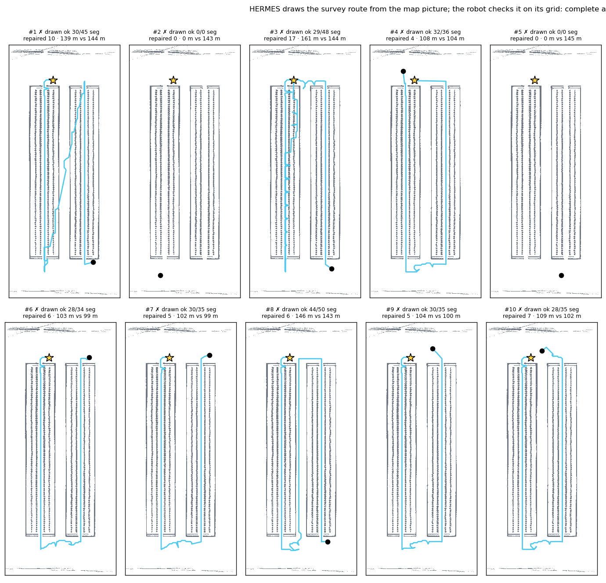 | HERMES draws the survey route itself from the robot's map picture (metre axes, drivable space, rows, dock, robot); blue = the route after the robot checked it on its grid, ● = start, ★ = dock; 8 of 12 drawn, 251 of 318 segments drivable as drawn, 60 repaired by the planner, 6 of 8 complete once row legs are snapped to the row centre; ten start poses in two rows |
| 34 | 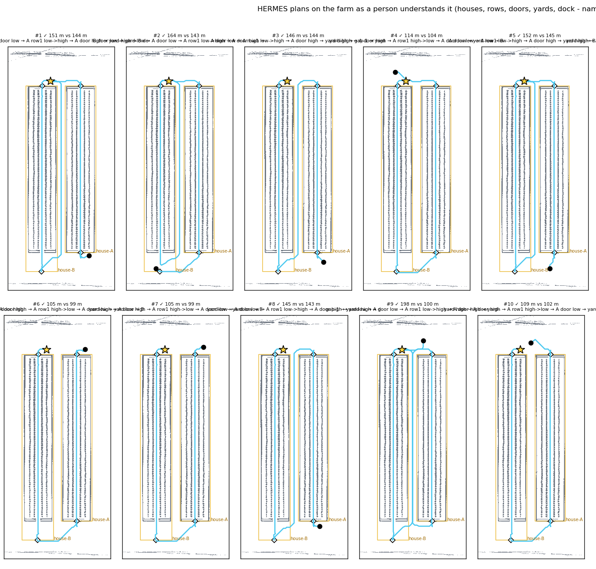 | HERMES plans on the farm as a person understands it: the robot's scene graph (houses outlined in yellow, doors ◆, rows, yards, dock) and the route it chose as named places, turned into geometry by the robot; 12 of 12 complete and drivable, 7 % longer than the Rural Postman + A* plan; ten start poses in two rows |
| 35 | 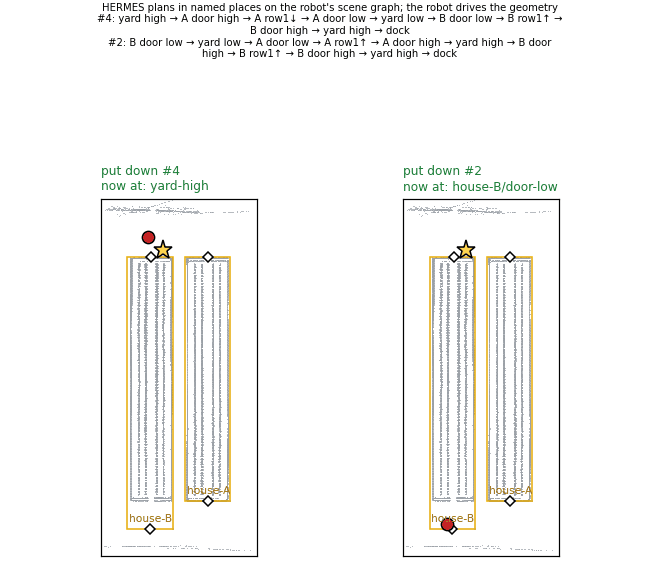 | Animated: HERMES's plan on the robot's scene graph for two put-downs, the robot moving place to place with the place it is at named as it gets there (houses outlined, doors ◆, dock ★) |
| 36 | 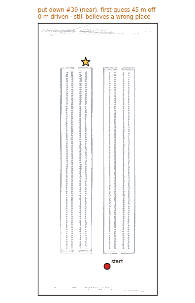 | Animated: three put-down surveys as they were really driven, side by side: one that knew where it was from the start, two that started with a wrong guess (2 m and 46 m off) and worked out their true position within 1 m (○); blue = the path driven, ● = start, ★ = dock |
